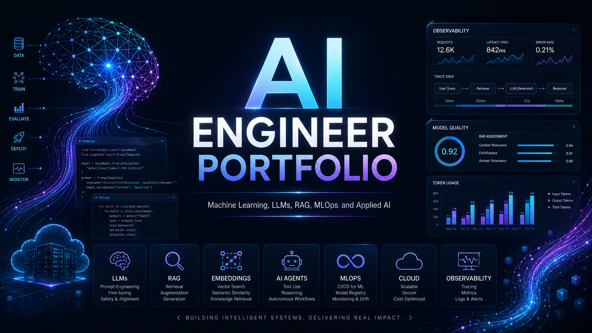
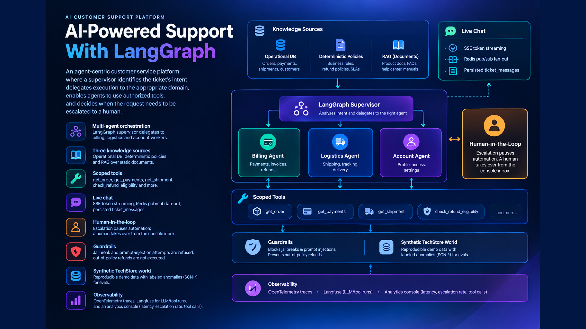
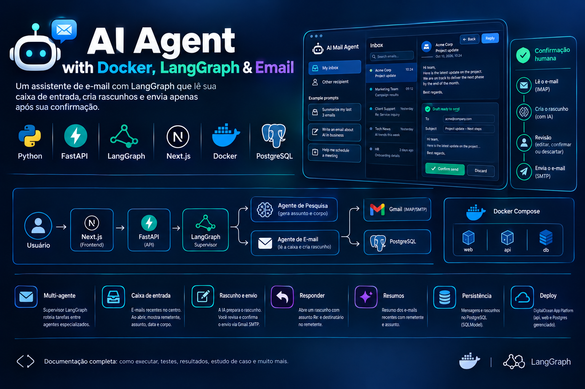
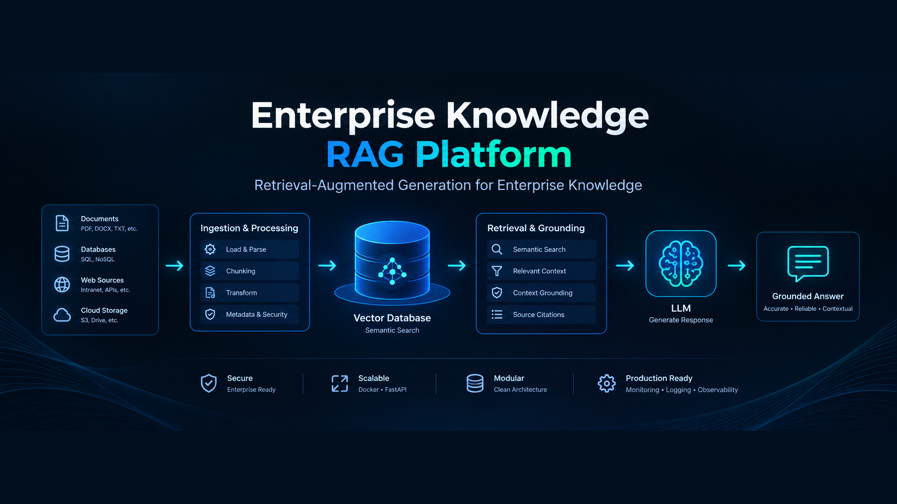
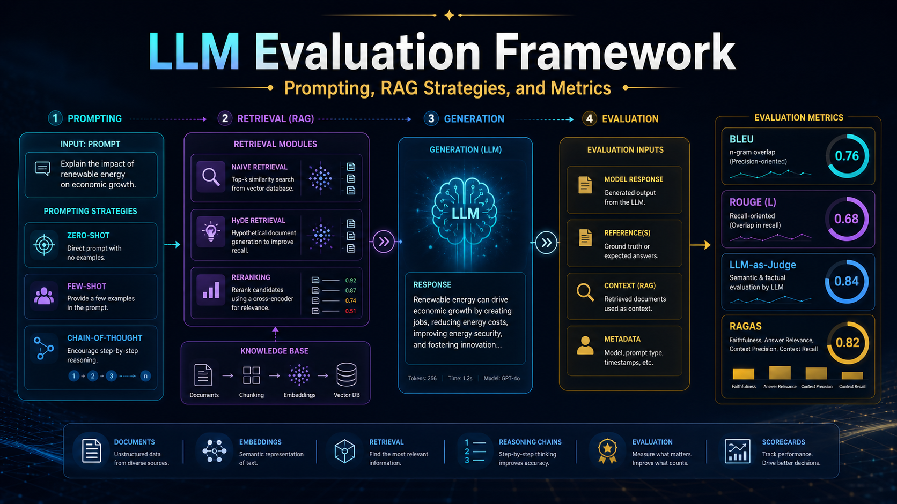
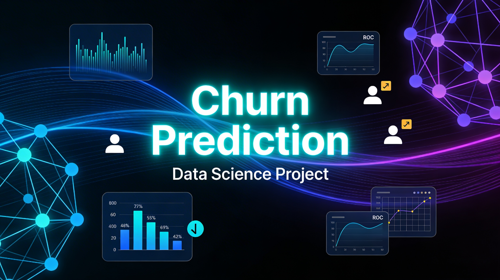
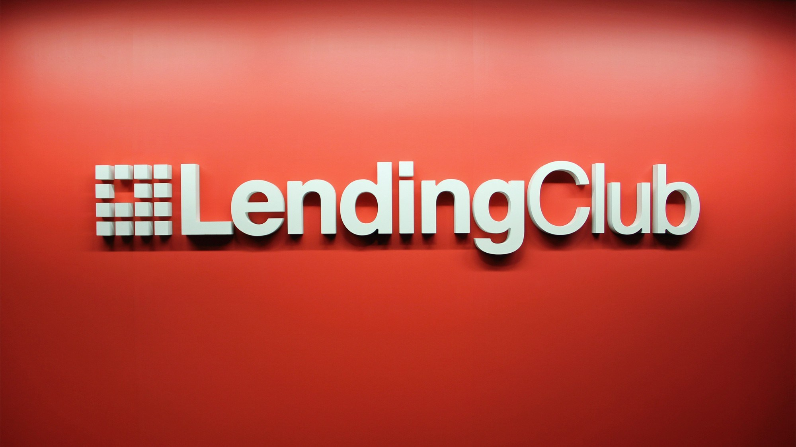

**Language:** English | [Português](README.pt-BR.md)

  <h1>AI Engineer Portfolio</h1>
  
<strong>Otniel Gomes</strong> — I build and evaluate LLM-powered systems with measurable quality, latency, and observability.

  

    
    
    
    
    
    
    
  

  

---

RAG pipelines, multi-agent assistants, and benchmark frameworks — built so the interesting claims can be checked. Business rules live in code rather than in prompts, retrieval quality gets measured instead of assumed, and every project here links to the repository that produced it.

Open to **AI Engineering, LLM Systems, and applied Generative AI** roles and collaborations.

| Focus area | Skills |
|---|---|
| **AI Engineering** | LangGraph multi-agent systems, RAG (Naive, HyDE, Reranking), FastAPI, Next.js, Docker |
| **Evaluation & Observability** | RAGAS, BLEU, ROUGE, LLM-as-Judge, LangSmith, Langfuse, OpenTelemetry |
| **Data & Modeling** | CRISP-DM, scikit-learn, XGBoost, LightGBM, PyTorch, Azure Databricks |
| **Data & Infrastructure** | PostgreSQL, pgvector, Redis, ChromaDB, Docker Compose, GitHub Actions |

---

## Project index

| Project | Problem | Stack | Highlight |
|---|---|---|---|
| [AI Customer Support Platform](projects/ai-customer-support-platform.md) | Answer about real orders without hallucinating, and escalate when policy forbids acting | LangGraph, FastAPI, Next.js, PostgreSQL/pgvector, Redis | Multi-agent supervisor with deterministic policy engine and human-in-the-loop |
| [AI Agent with Docker](projects/ai-agent-email-docker.md) | Read the inbox and draft mail without sending until a person confirms | LangGraph, FastAPI, Next.js, PostgreSQL, Docker | SMTP runs only after the draft is confirmed |
| [PGD Teletrabalho](projects/pgd-teletrabalho.md) | Answer current telework rules from the act in force, or refuse | FastAPI, Next.js, PostgreSQL, Docker | Citation gate; **89** pytest passed |
| [LLM-Eval-Suite](projects/llm-eval-suite.md) | Compare LLMs and RAG strategies objectively | Ollama, ChromaDB, RAGAS, LangSmith | **0.988** composite RAGAS (HyDE, Gemma3 27B) |
| [Credit Card Churn Prediction](projects/churn-prediction-credit-card.md) | Identify credit-card customers at risk of leaving | XGBoost, LightGBM, scikit-learn, SHAP | End-to-end CRISP-DM pipeline with explainability |
| [Credit Risk Classification](projects/credit-risk-classification.md) | Classify loan default risk at application time | PyTorch, Azure Databricks | **71.08%** AUC-ROC on test data |
| [Customer Segmentation](projects/clustering-segmentation.md) | Discover natural groupings in customer data | scikit-learn, CRISP-DM | In progress |

---

## Featured project

### [AI Customer Support Platform](projects/ai-customer-support-platform.md) 🎧

  

A LangGraph **supervisor** routes each support ticket to billing, logistics, or account workers. Those workers read order facts from **PostgreSQL**, retrieve procedures through **RAG over pgvector**, and run a **deterministic policy engine** before any refund or cancellation — so the assistant never invents order state and never approves what the policy forbids.

Two surfaces: a Customer Portal for shoppers and a Support Console where a human takes over an escalated ticket in the same thread, with the assistant's tool trail visible. Deployed on DigitalOcean App Platform with OpenTelemetry and Langfuse tracing.

**[Read the full case study →](projects/ai-customer-support-platform.md)** · [Source repository](https://github.com/OtnielGomes/AI-Customer-Support-Platform-With-Langgraph)

---

## AI Engineering

### [AI Agent with Docker Containers and Python](projects/ai-agent-email-docker.md) 🤖

  

The assistant reads the inbox and prepares a draft, and Gmail SMTP runs only after that card is confirmed. A **LangGraph supervisor** routes research and email work. Next.js shows the inbox, the chat, and the review card; FastAPI and PostgreSQL store messages and drafts. Docker Compose locally; DigitalOcean App Platform in production.

**[Read more →](projects/ai-agent-email-docker.md)** · [Source repository](https://github.com/OtnielGomes/AI-Agent-with-Docker-Containers-and-Python)

---

### [PGD Teletrabalho](projects/pgd-teletrabalho.md) 📜

  

A Unifesp servidor asking about telework needs the rule that is actually in force, with an article they can open. **Ask** retrieves from a dated snapshot of five normative acts, drafts an answer, then a **deterministic citation gate** keeps only citations whose article was retrieved. What the snapshot cannot support comes back as **Insufficient Evidence**. Resolução CONSU 213/2021 is cited only on a historical question.

**89** pytest passed with the extractive draft and an empty API key, including a human-annotated golden set of **43** items. Corpus cutoff: **18 September 2026**.

**[Read more →](projects/pgd-teletrabalho.md)** · [Source repository](https://github.com/OtnielGomes/Enterprise-Knowledge---RAG-Platform)

---

### [LLM-Eval-Suite](projects/llm-eval-suite.md) 🧪

  

Picking a model and a retrieval strategy by intuition does not survive review. This benchmark compares prompting strategies (Zero-Shot, Few-Shot, CoT) and RAG strategies (Naive, HyDE, Reranking) across models using BLEU, ROUGE, LLM-as-Judge, and RAGAS, traced end to end in LangSmith.

Best composite RAGAS score: **0.988** with HyDE on Gemma3 27B. Best prompting accuracy: **89.3%** mean with Qwen3-Coder 480B.

**[Read more →](projects/llm-eval-suite.md)** · [Source repository](https://github.com/OtnielGomes/LLM-Eval-Suite)

---

## Data Science

### [Credit Card Churn Prediction](projects/churn-prediction-credit-card.md) 💳

  

A bank loses revenue when card holders leave without warning. Full **CRISP-DM** pipeline — EDA, feature engineering, and a comparison across Logistic Regression, SVM, KNN, Random Forest, XGBoost, and LightGBM with stratified splits and calibration analysis. Ships a serialized model and a high-risk customer list for retention campaigns, with SHAP explaining each prediction.

**[Read more →](projects/churn-prediction-credit-card.md)** · [Source repository](https://github.com/OtnielGomes/Churn-Prediction-Credit-Card)

---

### [Credit Risk Classification](projects/credit-risk-classification.md) 💸

  

Default risk has to be assessed using only what is known before approval. A **PyTorch** network trained on LendingClub data in **Azure Databricks**, paired with a four-level risk classifier that routes each application to approval, denial, or reassessment. **71.08% AUC-ROC**, 66.42% accuracy, and 63.87% recall on test data.

**[Read more →](projects/credit-risk-classification.md)** · [Source repository](https://github.com/OtnielGomes/0_Portfolio-Credit_Risk_Analysis_with_Pytorch)

---

### [Customer Segmentation with Clustering](projects/clustering-segmentation.md) 📊

Unsupervised segmentation to find natural customer groupings — CRISP-DM workflow with K-Means and hierarchical clustering, evaluated by silhouette score.

> [!NOTE]
> In progress — repository and full analysis coming soon.

**[Read more →](projects/clustering-segmentation.md)**

---

## About this repository

This is a **showcase portfolio** documenting my work in **AI Engineering** (primary focus) and **Data Science** (complementary study area). Each project lives in its own repository with the full source code; this repo holds the case studies, architecture diagrams, benchmark results, and demo media that tie them together.

Distributed under the MIT License — see [`LICENSE`](LICENSE).

## Contact

[![LinkedIn][linkedin-shield]][linkedin-url]
[![GitHub][github-shield]][github-url]

**Otniel Gomes** — AI Engineer

- GitHub: [@OtnielGomes](https://github.com/OtnielGomes)
- LinkedIn: [linkedin.com/in/otnielgomes](https://linkedin.com/in/otnielgomes)

(<a href="#readme-top">back to top</a>)

[linkedin-shield]: https://img.shields.io/badge/-LinkedIn-black.svg?style=for-the-badge&logo=linkedin&colorB=555
[linkedin-url]: https://linkedin.com/in/otnielgomes

[github-shield]: https://img.shields.io/badge/-GitHub-black.svg?style=for-the-badge&logo=github&colorB=555
[github-url]: https://github.com/OtnielGomes
