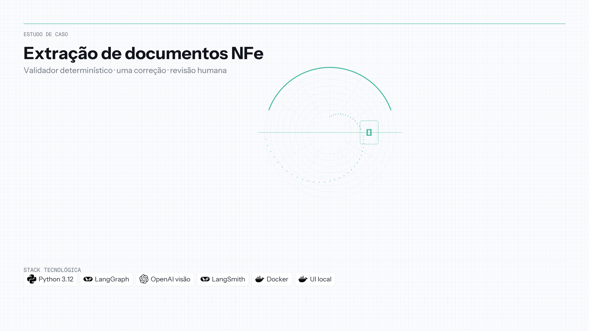
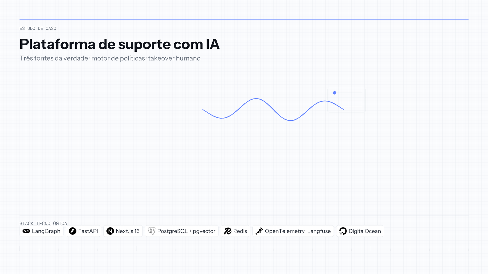
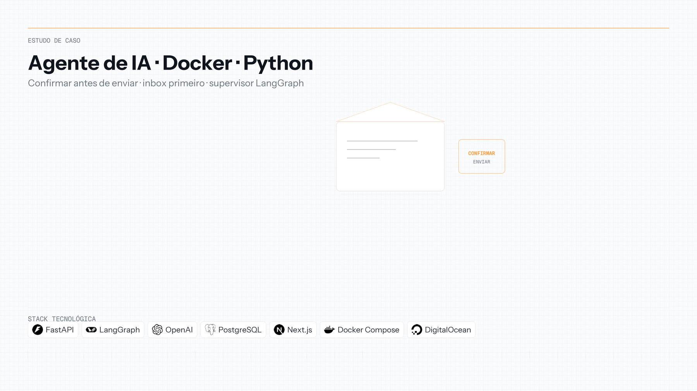
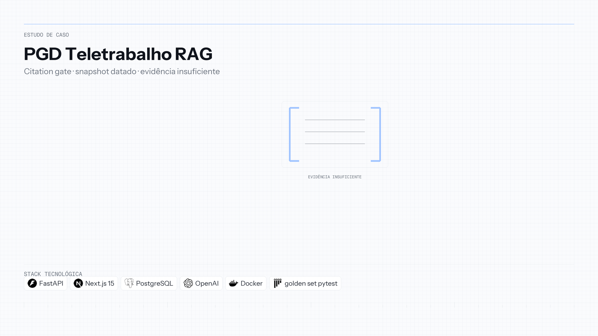
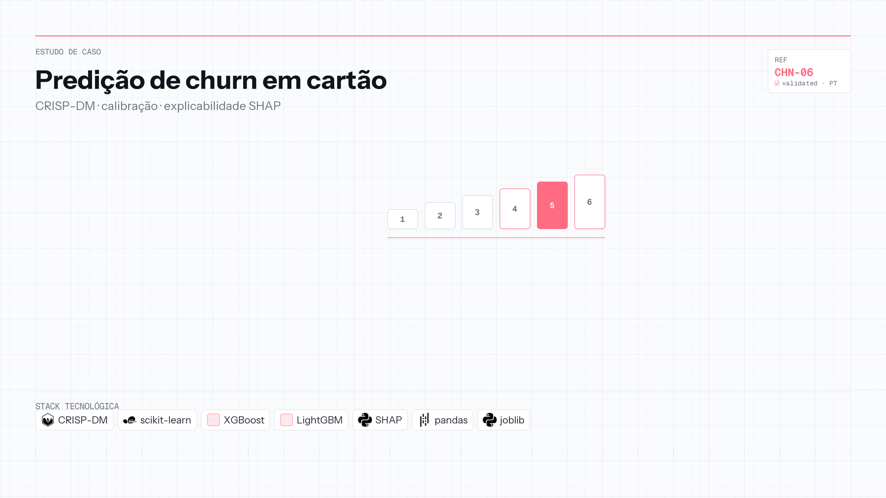
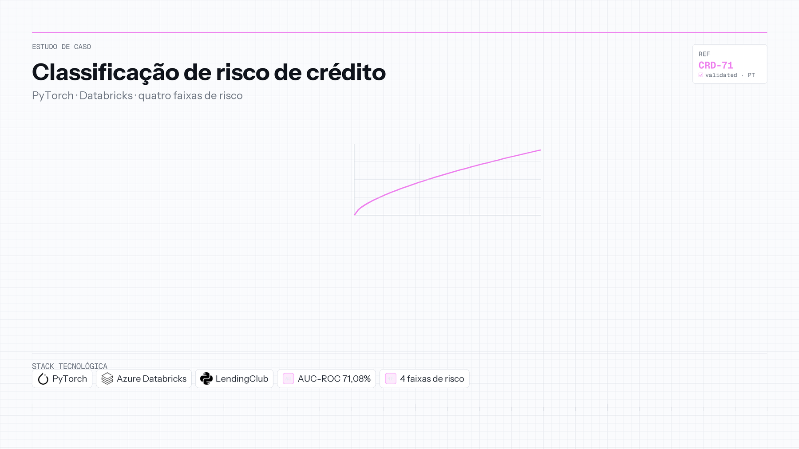

**Idioma:** [English](README.md) | Português

  <h1>Portfólio de AI Engineer</h1>
  
<strong>Otniel Gomes</strong> — construo e avalio sistemas baseados em LLM com qualidade, latência e observabilidade mensuráveis.

  

    
    
    
    
    
    
    
  

  

---

Extração de documentos com validação determinística, pipelines de RAG e assistentes multi-agente — construídos para que as afirmações interessantes possam ser verificadas. Regras de negócio ficam no código, não no prompt; a qualidade da recuperação é medida em vez de presumida; e cada projeto aqui aponta para o repositório que o originou.

Aberto a oportunidades e colaborações em **AI Engineering, sistemas com LLM e IA Generativa aplicada**.

| Área de foco | Competências |
|---|---|
| **AI Engineering** | Sistemas multi-agente com LangGraph, RAG (Naive, HyDE, Reranking), FastAPI, Next.js, Docker |
| **Avaliação e observabilidade** | RAGAS, BLEU, ROUGE, LLM-as-Judge, LangSmith, Langfuse, OpenTelemetry |
| **Dados e modelagem** | CRISP-DM, scikit-learn, XGBoost, LightGBM, PyTorch, Azure Databricks |
| **Dados e infraestrutura** | PostgreSQL, pgvector, Redis, ChromaDB, Docker Compose, GitHub Actions |

> [!NOTE]
> Cada projeto tem estudo de caso em português (`projects/<slug>.pt-BR.md`) e em inglês (`projects/<slug>.md`).

---

## Índice de projetos

| Projeto | Problema | Stack | Destaque |
|---|---|---|---|
| [Extração de Documentos NF-e](projects/nfe-document-extraction.pt-BR.md) | Transformar um DANFE em PDF ou foto em JSON validado e apontar os campos que uma pessoa precisa revisar | LangGraph, OpenAI, LangSmith, Docker | Visão barata, `gpt-6-luna`: acurácia de campo **0,9870** em PDF digital |
| [AI Customer Support Platform](projects/ai-customer-support-platform.pt-BR.md) | Responder sobre pedidos reais sem alucinar e escalar quando a política impede agir | LangGraph, FastAPI, Next.js, PostgreSQL/pgvector, Redis | Supervisor multi-agente com políticas determinísticas e human-in-the-loop |
| [AI Agent com Docker](projects/ai-agent-email-docker.pt-BR.md) | Ler a caixa de entrada e redigir e-mails, enviando só depois da confirmação | LangGraph, FastAPI, Next.js, PostgreSQL, Docker | O SMTP só dispara depois que o rascunho é confirmado |
| [PGD Teletrabalho](projects/pgd-teletrabalho.pt-BR.md) | Responder regras vigentes de teletrabalho a partir do ato em vigor, ou recusar | FastAPI, Next.js, PostgreSQL, Docker | Portão de citação; **89** testes pytest |
| [Previsão de Churn de Cartão](projects/churn-prediction-credit-card.pt-BR.md) | Identificar clientes de cartão com risco de sair | XGBoost, LightGBM, scikit-learn, SHAP | Pipeline CRISP-DM completo com explicabilidade |
| [Classificação de Risco de Crédito](projects/credit-risk-classification.pt-BR.md) | Classificar risco de inadimplência no momento da solicitação | PyTorch, Azure Databricks | **71,08%** de AUC-ROC no teste |

---

## Projeto destaque

### [Extração de Documentos NF-e](projects/nfe-document-extraction.pt-BR.md) 📄

  

**Problema:** O DANFE chega em PDF ou em foto de celular, e a contabilidade ainda digita os campos à mão.

**Solução:** Agentes de cabeçalho e de itens extraem a nota; um validador determinístico, uma tentativa de reparo e a revisão humana aceitam ou seguram cada campo.

**Resultado:** A visão barata adotada, com `gpt-6-luna`, chega a **0,9870** de acurácia de campo em PDF digital a **US$ 0,002035** por nota, e a **0,6420** em foto simulada; a detecção de erro plantado é **1,0000** nos dois casos.

**[Ler o estudo de caso completo →](projects/nfe-document-extraction.pt-BR.md)** · [Repositório](https://github.com/OtnielGomes/NFe-Document-Extraction)

---

## AI Engineering

### [AI Customer Support Platform](projects/ai-customer-support-platform.pt-BR.md) 🎧

  

Um **supervisor LangGraph** identifica a intenção de cada ticket e delega para agentes de cobrança, logística ou conta. Esses agentes leem os fatos do pedido no **PostgreSQL**, recuperam procedimentos por **RAG com pgvector** e executam um **motor de políticas determinístico** antes de qualquer reembolso ou cancelamento — de modo que o assistente nunca inventa o estado do pedido nem aprova o que a política proíbe.

São duas interfaces: um Portal do Cliente para o consumidor e um Console de Suporte onde um atendente humano assume o ticket escalado dentro da mesma conversa, com o rastro de ferramentas que o assistente já executou. Publicado na DigitalOcean App Platform, com tracing via OpenTelemetry e Langfuse.

**[Ver detalhes →](projects/ai-customer-support-platform.pt-BR.md)** · [Repositório](https://github.com/OtnielGomes/AI-Customer-Support-Platform-With-Langgraph)

---

### [AI Agent com Docker Containers e Python](projects/ai-agent-email-docker.pt-BR.md) 🤖

  

O assistente lê a caixa de entrada e prepara um rascunho; o SMTP do Gmail só dispara depois que esse cartão é confirmado. Um **supervisor LangGraph** encaminha pesquisa e e-mail. O Next.js mostra a caixa, o chat e o cartão de revisão; FastAPI e PostgreSQL guardam mensagens e rascunhos. Docker Compose no local; DigitalOcean App Platform em produção.

**[Ver detalhes →](projects/ai-agent-email-docker.pt-BR.md)** · [Repositório](https://github.com/OtnielGomes/AI-Agent-with-Docker-Containers-and-Python)

---

### [PGD Teletrabalho](projects/pgd-teletrabalho.pt-BR.md) 📜

  

Um servidor da Unifesp que pergunta sobre teletrabalho precisa da regra que está em vigor, com um artigo que dá para abrir. O **Ask** recupera de um recorte datado de cinco atos normativos, redige a resposta e um **portão de citação determinístico** só deixa passar citação cujo artigo foi recuperado. O que o recorte não sustenta volta como **Evidência Insuficiente**. A Resolução CONSU 213/2021 só entra em pergunta histórica.

**89** testes pytest passaram com o rascunho extrativo e a chave de API vazia, incluindo um golden set de **43** itens anotados por uma pessoa. Corte do corpus: **18 de setembro de 2026**.

**[Ver detalhes →](projects/pgd-teletrabalho.pt-BR.md)** · [Repositório](https://github.com/OtnielGomes/Enterprise-Knowledge---RAG-Platform)

---

## Ciência de Dados

### [Previsão de Churn de Cartão de Crédito](projects/churn-prediction-credit-card.pt-BR.md) 💳

  

Um banco perde receita quando o cliente de cartão sai sem aviso. Pipeline **CRISP-DM** completo — EDA, engenharia de atributos e comparação entre Regressão Logística, SVM, KNN, Random Forest, XGBoost e LightGBM, com divisão estratificada e análise de calibração. Entrega um modelo serializado e uma lista de clientes de alto risco para campanhas de retenção, com SHAP explicando cada previsão.

**[Ver detalhes →](projects/churn-prediction-credit-card.pt-BR.md)** · [Repositório](https://github.com/OtnielGomes/Churn-Prediction-Credit-Card)

---

### [Classificação de Risco de Crédito](projects/credit-risk-classification.pt-BR.md) 💸

  

O risco de inadimplência precisa ser avaliado apenas com o que se sabe antes da aprovação. Uma rede neural em **PyTorch** treinada com dados da LendingClub no **Azure Databricks**, combinada a um classificador de risco em quatro níveis que direciona cada solicitação para aprovação, negação ou reavaliação. **71,08% de AUC-ROC**, 66,42% de acurácia e 63,87% de recall no teste.

**[Ver detalhes →](projects/credit-risk-classification.pt-BR.md)** · [Repositório](https://github.com/OtnielGomes/0_Portfolio-Credit_Risk_Analysis_with_Pytorch)

---

## Sobre este repositório

Este é um **portfólio de demonstração** documentando meu trabalho em **AI Engineering** (foco principal) e **Ciência de Dados** (área complementar de estudo). Cada projeto vive no próprio repositório com o código-fonte completo; aqui ficam os estudos de caso, diagramas de arquitetura, resultados de benchmark e mídias de demonstração que os conectam.

Distribuído sob a licença MIT — veja [`LICENSE`](LICENSE).

## Contato

[![LinkedIn][linkedin-shield]][linkedin-url]
[![GitHub][github-shield]][github-url]

**Otniel Gomes** — AI Engineer

- GitHub: [@OtnielGomes](https://github.com/OtnielGomes)
- LinkedIn: [linkedin.com/in/otnielgomes](https://linkedin.com/in/otnielgomes)

(<a href="#readme-top">voltar ao topo</a>)

[linkedin-shield]: https://img.shields.io/badge/-LinkedIn-black.svg?style=for-the-badge&logo=linkedin&colorB=555
[linkedin-url]: https://linkedin.com/in/otnielgomes

[github-shield]: https://img.shields.io/badge/-GitHub-black.svg?style=for-the-badge&logo=github&colorB=555
[github-url]: https://github.com/OtnielGomes
