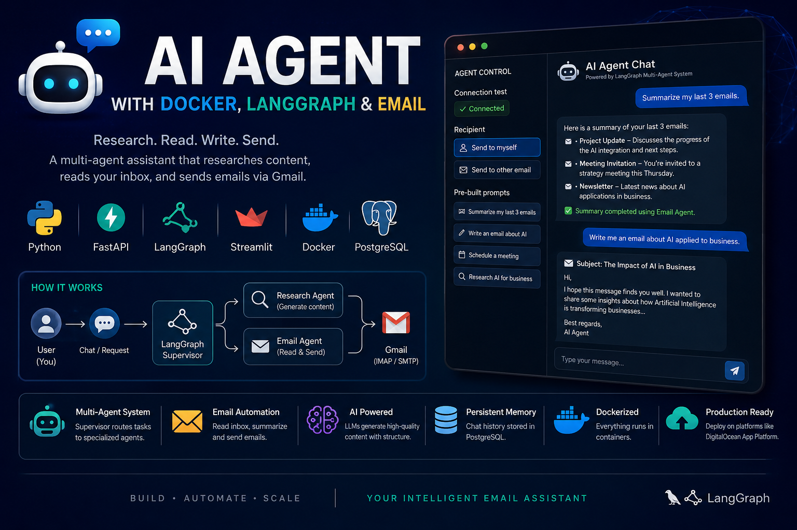
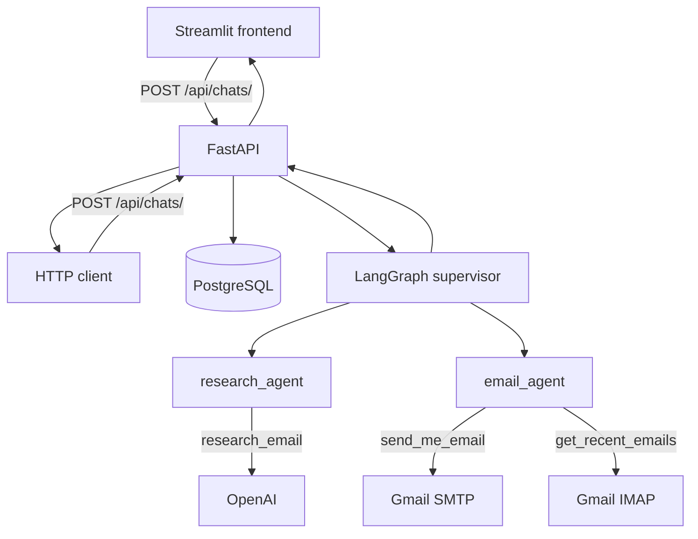
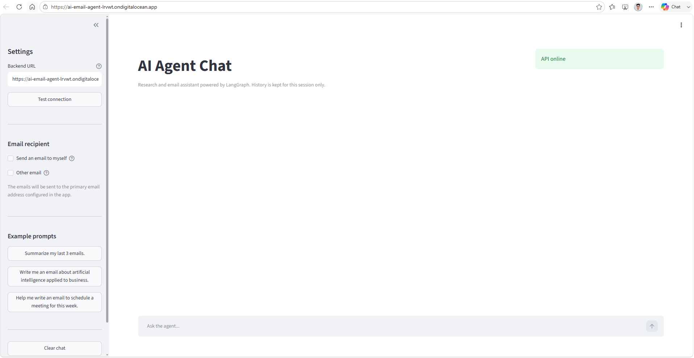
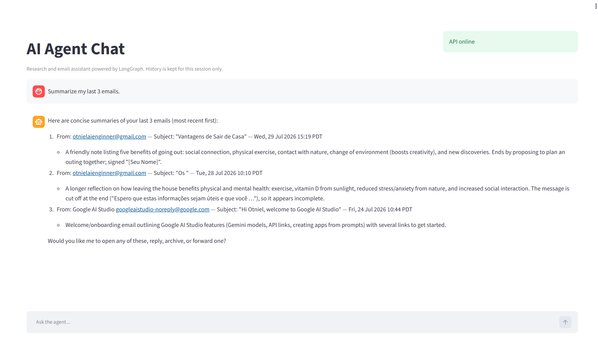
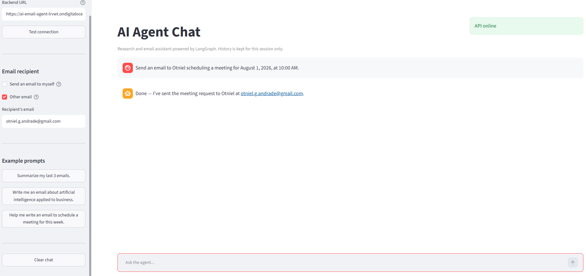
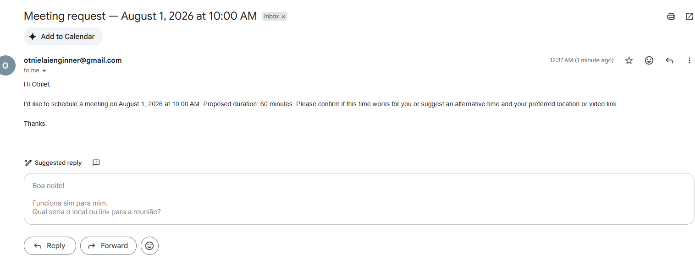
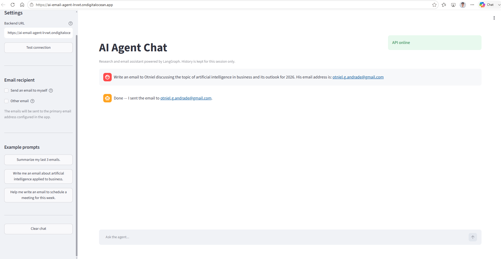
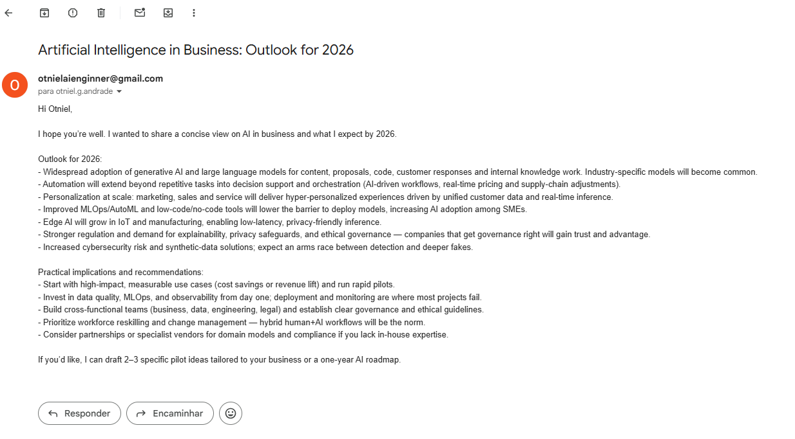
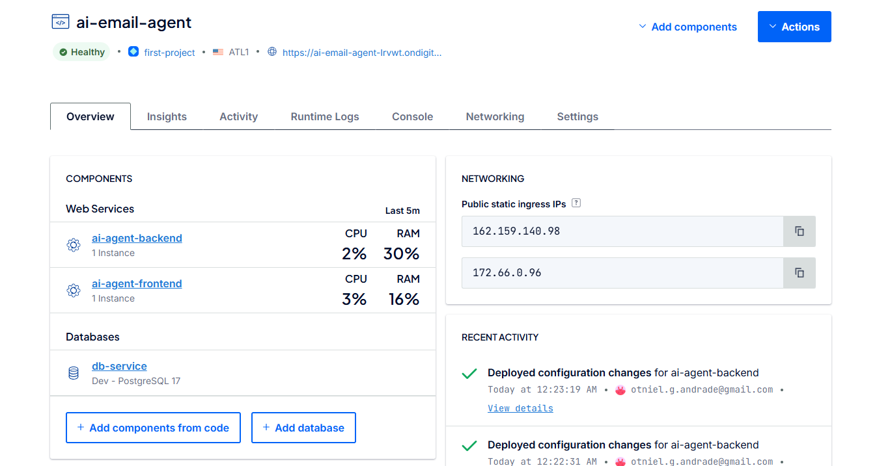

[← Back to portfolio](../README.md)

# AI Agent with Docker Containers and Python 🤖

**Repository:** [AI-Agent-with-Docker-Containers-and-Python](https://github.com/OtnielGomes/AI-Agent-with-Docker-Containers-and-Python)

  

**Problem:** Manual email workflows — researching topics, reading the inbox, and drafting replies — are slow and repetitive.

**Solution:** A **LangGraph multi-agent** assistant with a supervisor routing tasks to research and email workers. **FastAPI** handles the API, **PostgreSQL** stores chat history, **Streamlit** provides the UI, and **Docker Compose** packages everything for local and cloud deployment.

**Result:** End-to-end assistant deployed on **DigitalOcean App Platform**, capable of summarizing inbox messages and sending structured emails via Gmail.

## Architecture

| Layer | Technology | Responsibility |
|-------|------------|----------------|
| API | FastAPI, uvicorn | HTTP routes, validation, persistence |
| Agents | LangGraph, langgraph-supervisor | Supervisor + workers (research, email) |
| LLM | langchain-openai | Structured email generation |
| Email | smtplib, IMAP | Send and read via Gmail |
| Database | SQLModel, PostgreSQL | Chat message history |
| UI | Streamlit | Chat, recipient settings, prompts |
| Containers | Docker Compose | Local orchestration and production base |

## Demos

View demos, deployment, and observability

### Agent interface

Sidebar with connection test, recipient choice (*send to myself* or *other email*), and pre-built prompts.

### Summarize recent emails

Request: *"Summarize my last 3 emails."* — the agent reads the inbox and returns a structured summary.

### Schedule a meeting by email

Request: *"Help me write an email to schedule a meeting for this week."*

<table>
  <tr>
    <td width="50%"></td>
    <td width="50%"></td>
  </tr>
</table>

### Email about Artificial Intelligence

Request: *"Write me an email about artificial intelligence applied to business."*

<table>
  <tr>
    <td width="50%"></td>
    <td width="50%"></td>
  </tr>
</table>

### Deployment on DigitalOcean

### Runtime logs

(<a href="#top">back to top</a>)

