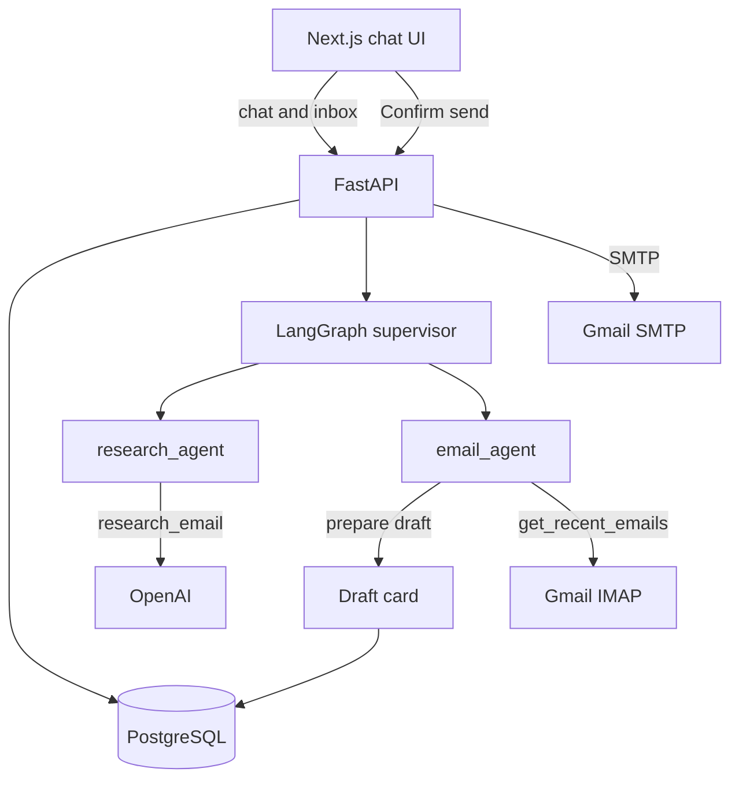

[← Back to portfolio](../README.md)

# AI Agent with Docker Containers and Python 🤖

**Repository:** [AI-Agent-with-Docker-Containers-and-Python](https://github.com/OtnielGomes/AI-Agent-with-Docker-Containers-and-Python)

  

**Problem:** An assistant that mails as soon as it finishes a draft will send the wrong recipient or the wrong text, and there is no step where a person can stop it. Reading the inbox and writing the message still has to be faster than doing both by hand.

**Solution:** A **LangGraph supervisor** routes each turn to a research worker, which writes the subject and a plain-text body, or to an email worker, which reads Gmail over IMAP, summarizes recent messages, and prepares an outbound draft. The **Next.js** UI keeps the inbox in the center of an empty conversation and opens a review card for every outbound message. **Confirm send** is the call that runs Gmail SMTP. **Discard** drops the card. A follow-up in the composer revises that same card instead of opening a second draft. **Reply** addresses the sender of the open message and ignores the recipient pinned in the sidebar.

**Result:** Inbox reading, drafting, in-place revision, reply, and confirm-before-send, with chat messages and drafts stored in **PostgreSQL**. Deployed on **DigitalOcean App Platform** as the API, the Next.js web app, and managed PostgreSQL.

## Architecture

| Layer | Technology | Responsibility |
|-------|------------|----------------|
| API | FastAPI, uvicorn | HTTP, validation, persistence |
| Agents | LangGraph, langgraph-supervisor | Supervisor, research, and email |
| LLM | langchain-openai | Subject and plain-text body |
| Email | smtplib, IMAP | Send on confirm, read via Gmail |
| Database | SQLModel, PostgreSQL | Messages and drafts |
| UI | Next.js | Inbox, chat, review card, prompts |
| Containers | Docker Compose | Local stack and the production base |

## Demos

Inbox, open, reply, and summarize

An empty conversation shows the inbox in the center. The sidebar pins **My inbox** or **Other recipient** and offers three example prompts.

Opening a message shows the sender, subject, date, and plain-text body, with **Back** and **Reply**.

**Reply** opens one draft whose subject starts with `Re:` and whose recipient is the sender. The address pinned in the sidebar stays out of that reply.

*Summarize my last 3 emails* returns the sender and subject of the recent messages.

Draft, revise, and confirm send

A prompt such as *Write an email about artificial intelligence applied to business* comes back as a card: subject, body, recipient, **Confirm send**, and **Discard**. SMTP runs only on confirm.

With the card open, a follow-up in the composer — shorten the body, change the subject — updates that same card. A second draft does not appear.

After **Confirm send**, the thread shows the message as sent.

Deployment — DigitalOcean App Platform

One Web App with three components: the API, the Next.js interface, and managed PostgreSQL.

> [!NOTE]
> Setup instructions and environment variables live in the [project repository](https://github.com/OtnielGomes/AI-Agent-with-Docker-Containers-and-Python).

(<a href="#top">back to top</a>)

