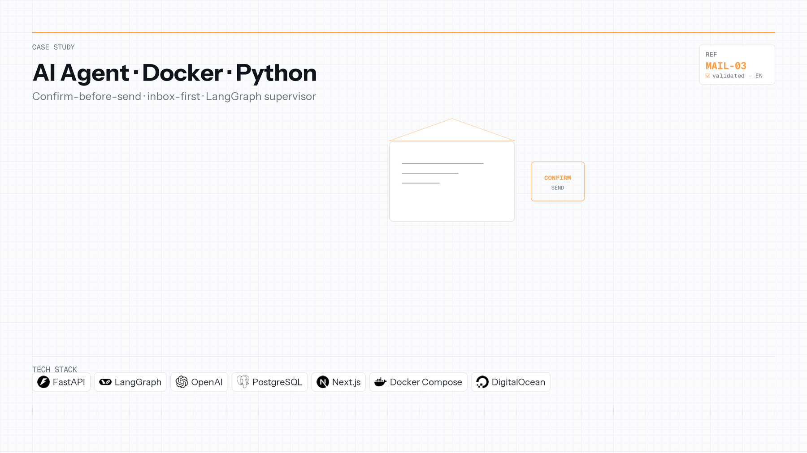
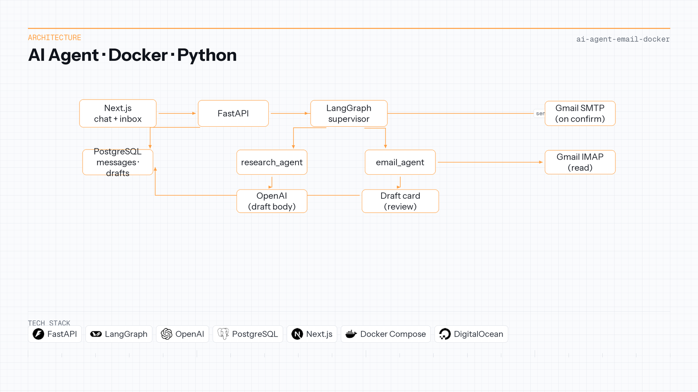

[← Back to portfolio](../README.md)

**Language:** English | [Português](ai-agent-email-docker.pt-BR.md)

# AI Agent with Docker Containers and Python 🤖

**Repository:** [AI-Agent-with-Docker-Containers-and-Python](https://github.com/OtnielGomes/AI-Agent-with-Docker-Containers-and-Python)

  

| | |
|---|---|
| **Context** | Independent portfolio |
| **Timeline** | 2025 — 2026 |
| **Focus area** | LangGraph agents & human-in-the-loop |

LangGraph · FastAPI · Next.js · PostgreSQL · Docker · OpenAI

## Overview

An assistant that sends email as soon as it finishes a draft will ship the wrong recipient or the wrong text, with no step where a person can stop it. Reading the inbox and drafting still has to be faster than doing both by hand.

A **LangGraph supervisor** routes each turn to a research worker (subject and plain-text body) or an email worker (Gmail over IMAP, recent-message summaries, outbound drafts). The **Next.js** UI keeps the inbox centered in an empty conversation and opens a **review card** for every outbound message. **Confirm send** is the only path to Gmail SMTP; **Discard** drops the card. Follow-ups in the composer revise the same card instead of spawning a second draft. **Reply** addresses the sender of the open message, not the sidebar pin.

Chat messages and drafts persist in **PostgreSQL**. The stack runs locally with Docker Compose and on **DigitalOcean App Platform** (API, web, managed Postgres).

## Architecture

End-to-end flow from chat and inbox through agents to confirm-before-send.

## Implementation walkthrough

### PHASE 01 — Request handling and session state

The FastAPI layer validates chat payloads, loads conversation history, and persists user and assistant turns in PostgreSQL via SQLModel. The UI proxies chat and inbox actions over HTTP; credentials for Gmail stay server-side.

### PHASE 02 — Supervisor routing

The LangGraph supervisor classifies each user message and delegates to **research_agent** (compose or revise email content) or **email_agent** (read inbox, prepare drafts, summarize threads). Tool boundaries keep IMAP reads separate from draft creation.

### PHASE 03 — Draft card and in-place revision

The email worker returns structured draft fields. The API stores the draft and the UI renders a card with subject, body, recipient, **Confirm send**, and **Discard**. A follow-up prompt updates that same draft record—no duplicate cards.

### PHASE 04 — Confirm-before-send

SMTP runs only after explicit confirmation. Until then, nothing leaves the server. Reply mode sets `Re:` and the original sender regardless of the sidebar’s pinned recipient.

### PHASE 05 — Containers and production deploy

Docker Compose wires API, Next.js, and Postgres for local parity. DigitalOcean App Platform runs the same three components with managed database and runtime logs.

## Tech stack deep-dive

### LangGraph

Models a supervisor plus specialized workers with explicit handoffs—easier to test and extend than a single monolithic prompt.

### FastAPI

Thin HTTP surface: validation, persistence, and agent invocation without leaking email credentials to the client.

### Next.js

Inbox-first UX and review cards make human-in-the-loop obvious; the dangerous action is never the default button.

### PostgreSQL

Durable chat and draft state so refresh and multi-step revision stay consistent.

### Docker

One command brings up the full stack for demos and matches the production topology.

### OpenAI (via LangChain)

Generates subjects and bodies; sending mail remains a separate, gated step.

## Demos

Inbox, open, reply, and summarize

An empty conversation shows the inbox in the center. The sidebar pins **My inbox** or **Other recipient** and offers three example prompts.

Opening a message shows the sender, subject, date, and plain-text body, with **Back** and **Reply**.

**Reply** opens one draft whose subject starts with `Re:` and whose recipient is the sender. The address pinned in the sidebar stays out of that reply.

*Summarize my last 3 emails* returns the sender and subject of the recent messages.

Draft, revise, and confirm send

A prompt such as *Write an email about artificial intelligence applied to business* comes back as a card: subject, body, recipient, **Confirm send**, and **Discard**. SMTP runs only on confirm.

With the card open, a follow-up in the composer — shorten the body, change the subject — updates that same card. A second draft does not appear.

After **Confirm send**, the thread shows the message as sent.

Deployment — DigitalOcean App Platform

One Web App with three components: the API, the Next.js interface, and managed PostgreSQL.

> [!NOTE]
> Setup instructions and environment variables live in the [project repository](https://github.com/OtnielGomes/AI-Agent-with-Docker-Containers-and-Python).

(<a href="#top">back to top</a>)

