

[← Voltar ao portfólio](../README.pt-BR.md)

**Idioma:** [English](ai-agent-email-docker.md) | Português

# Agente de e-mail com Docker Containers e Python 🤖

**Repositório:** [AI-Agent-with-Docker-Containers-and-Python](https://github.com/OtnielGomes/AI-Agent-with-Docker-Containers-and-Python)

  

| | |
|---|---|
| **Contexto** | Projeto de portfólio |
| **Linha do tempo** | 2025 — 2026 |
| **Foco** | Agentes LangGraph e human-in-the-loop |

LangGraph · FastAPI · Next.js · PostgreSQL · Docker · OpenAI

## Visão geral

Um assistente que dispara o e-mail assim que termina o rascunho pode errar destinatário ou texto, sem nenhuma etapa em que uma pessoa interrompa o envio. Ler a caixa de entrada e redigir ainda precisa ser mais rápido do que fazer tudo manualmente.

Um **supervisor LangGraph** encaminha cada turno para um worker de pesquisa (assunto e corpo em texto simples) ou para um worker de e-mail (Gmail via IMAP, resumos de mensagens recentes, rascunhos de saída). A interface **Next.js** mantém a inbox no centro da conversa vazia e abre um **card de revisão** para cada mensagem de saída. **Confirmar envio** é o único caminho para o SMTP do Gmail; **Descartar** remove o card. Novos pedidos no compositor **revisam o mesmo card**, sem segundo rascunho paralelo. **Responder** usa o remetente da mensagem aberta, não o endereço fixo na barra lateral.

Mensagens e rascunhos ficam no **PostgreSQL**. A stack roda localmente com Docker Compose e em produção no **DigitalOcean App Platform** (API, web, Postgres gerenciado).

## Arquitetura

Fluxo ponta a ponta do chat e da inbox até o envio só após confirmação.

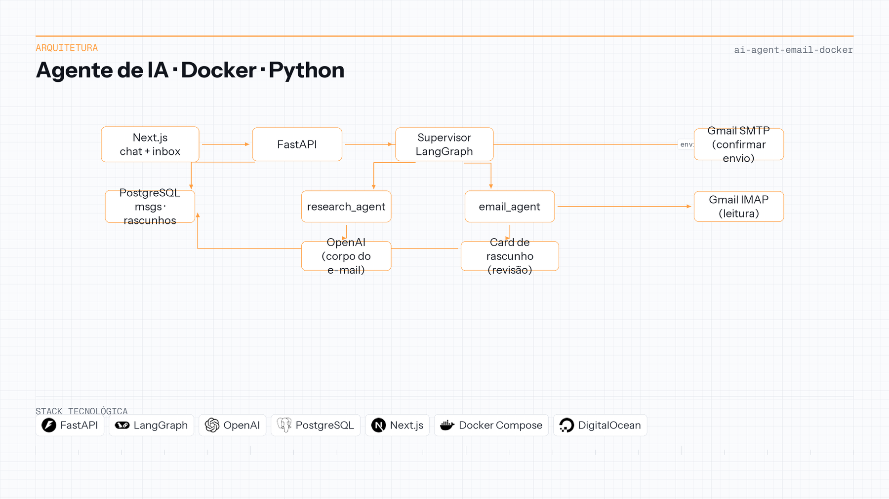

## Passo a passo da implementação

### FASE 01 — Requisições e estado da sessão

A camada FastAPI valida o payload do chat, carrega o histórico e persiste turnos de usuário e assistente no PostgreSQL (SQLModel). A UI chama a API por HTTP; credenciais do Gmail ficam só no servidor.

### FASE 02 — Roteamento do supervisor

O supervisor LangGraph classifica a mensagem e delega ao **research_agent** (redigir ou revisar conteúdo) ou ao **email_agent** (ler inbox, preparar rascunhos, resumir threads). Ferramentas separam leitura IMAP da criação de rascunhos.

### FASE 03 — Card de rascunho e revisão no lugar

O worker de e-mail devolve campos estruturados do rascunho. A API grava o rascunho e a UI mostra assunto, corpo, destinatário, **Confirmar envio** e **Descartar**. Um pedido de ajuste atualiza o mesmo registro—sem cards duplicados.

### FASE 04 — Envio só após confirmação

O SMTP só roda depois da confirmação explícita. Até lá, nada sai do servidor. No modo responder, o assunto ganha `Re:` e o destinatário é o remetente original, independente do pin na sidebar.

### FASE 05 — Containers e deploy

O Docker Compose liga API, Next.js e Postgres para paridade local. O App Platform da DigitalOcean executa os mesmos três componentes com banco gerenciado e logs de runtime.

## Stack em detalhe

### LangGraph

Supervisor e workers especializados com handoffs explícitos—mais testável que um único prompt monolítico.

### FastAPI

HTTP enxuto: validação, persistência e invocação dos agentes, sem expor credenciais de e-mail ao cliente.

### Next.js

UX com inbox em primeiro plano e cards de revisão; a ação perigosa nunca é o botão padrão.

### PostgreSQL

Estado durável de chat e rascunhos para revisão em vários passos sem perder contexto.

### Docker

Um comando sobe a stack inteira para demos e espelha a topologia de produção.

### OpenAI (via LangChain)

Gera assunto e corpo; o envio de mail continua em etapa separada e bloqueada.

## Demonstrações

Inbox, open, reply, and summarize

An empty conversation shows the inbox in the center. The sidebar pins **My inbox** or **Other recipient** and offers three example prompts.

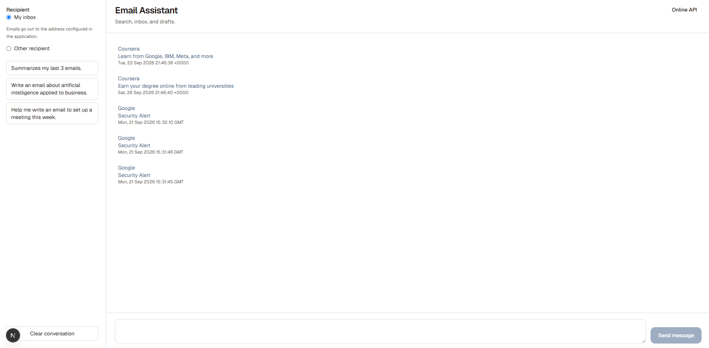

Opening a message shows the sender, subject, date, and plain-text body, with **Back** and **Reply**.

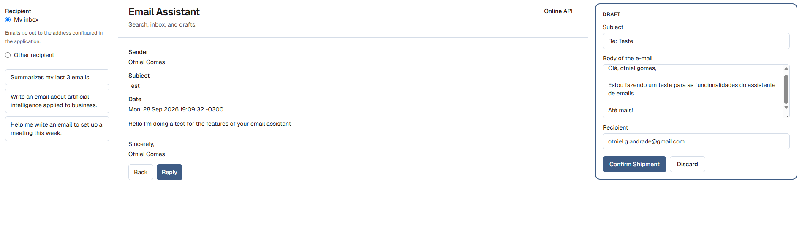

**Reply** opens one draft whose subject starts with `Re:` and whose recipient is the sender. The address pinned in the sidebar stays out of that reply.

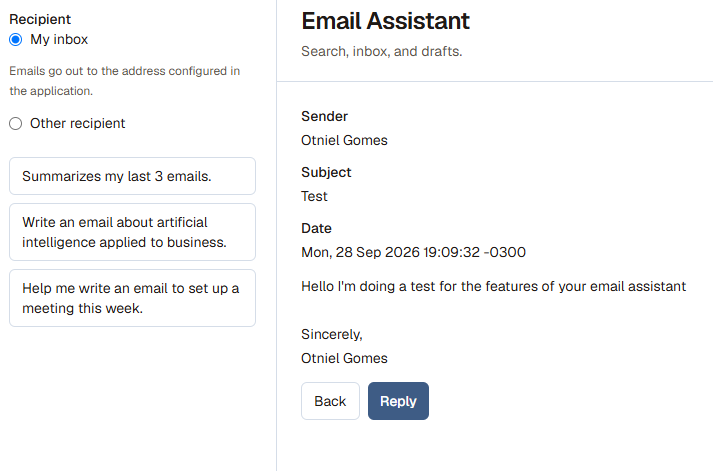

*Summarize my last 3 emails* returns the sender and subject of the recent messages.

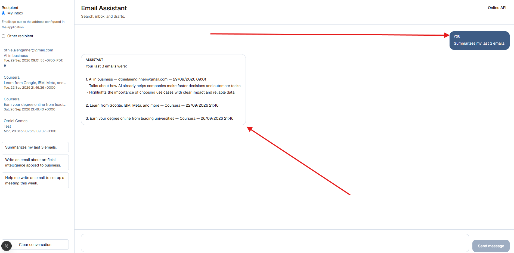

Draft, revise, and confirm send

A prompt such as *Write an email about artificial intelligence applied to business* comes back as a card: subject, body, recipient, **Confirm send**, and **Discard**. SMTP runs only on confirm.

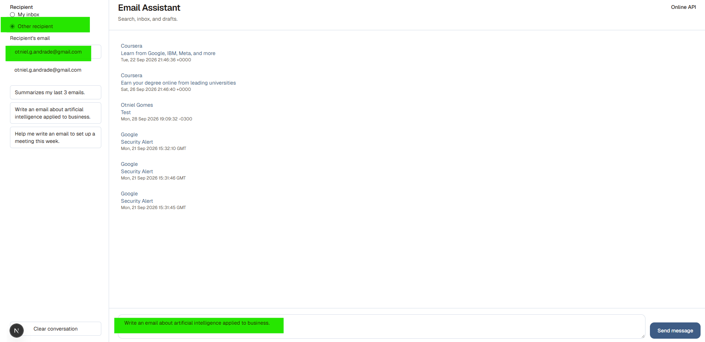

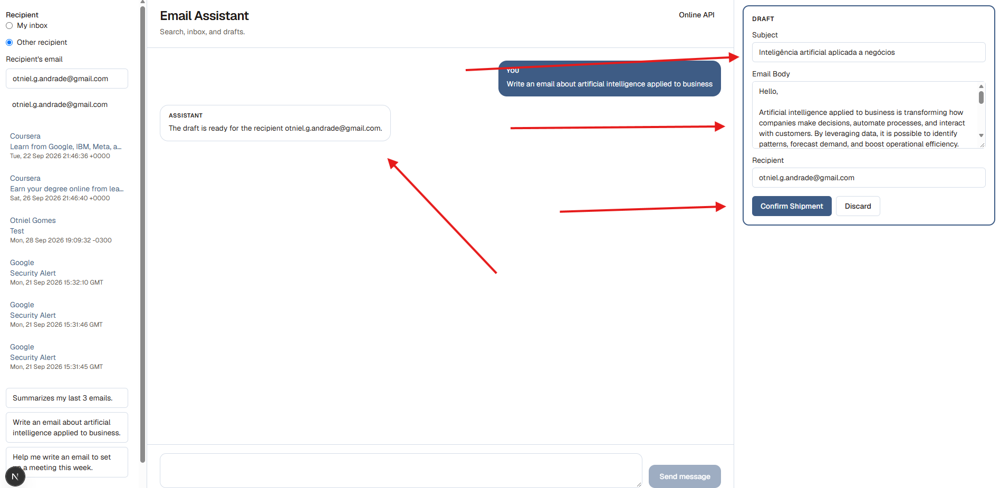

With the card open, a follow-up in the composer — shorten the body, change the subject — updates that same card. A second draft does not appear.

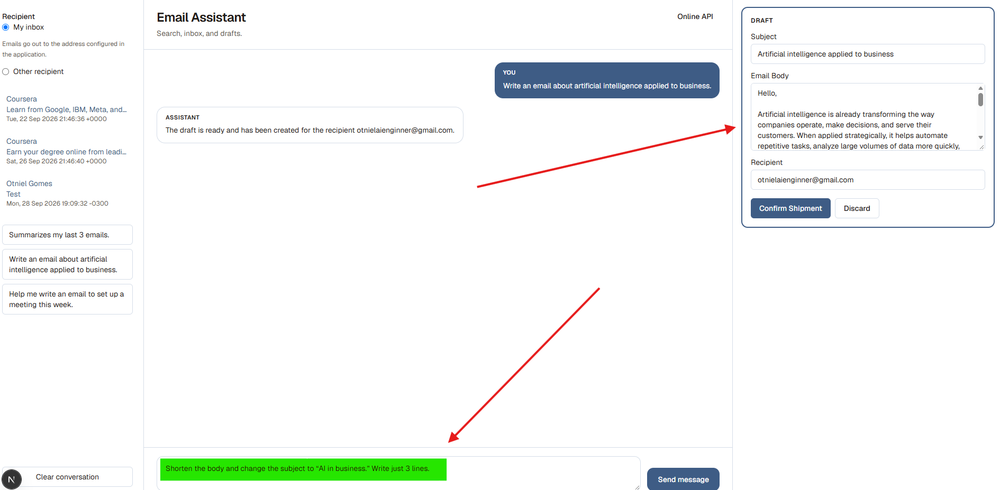

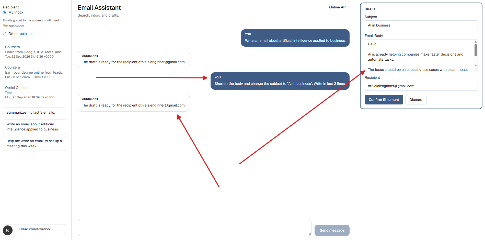

After **Confirm send**, the thread shows the message as sent.

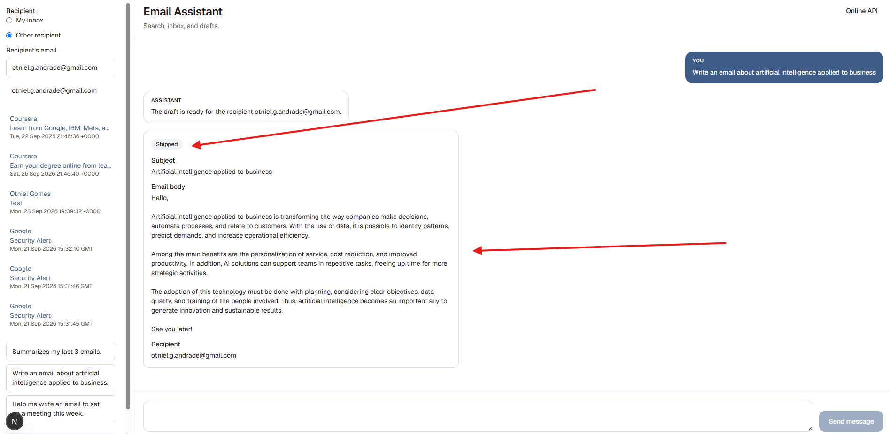

Deployment — DigitalOcean App Platform

One Web App with three components: the API, the Next.js interface, and managed PostgreSQL.

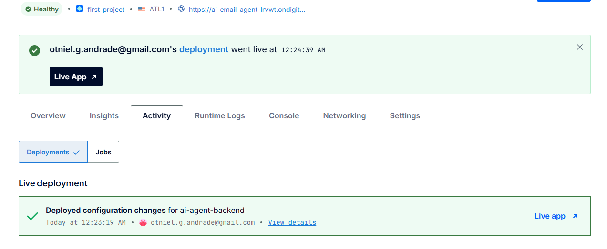

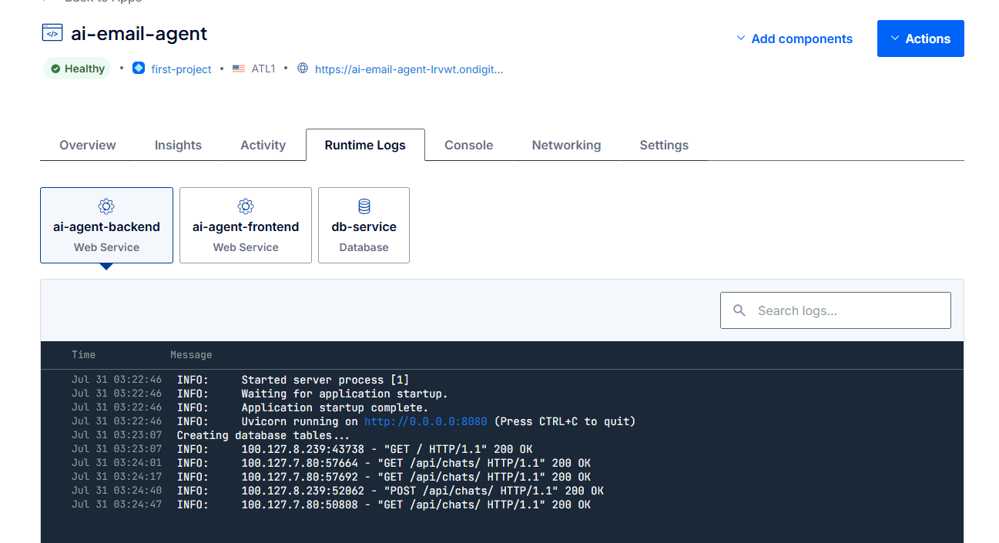

> [!NOTE]
> Instruções de setup e variáveis de ambiente estão no [repositório do projeto](https://github.com/OtnielGomes/AI-Agent-with-Docker-Containers-and-Python).

(<a href="#top">voltar ao topo</a>)

