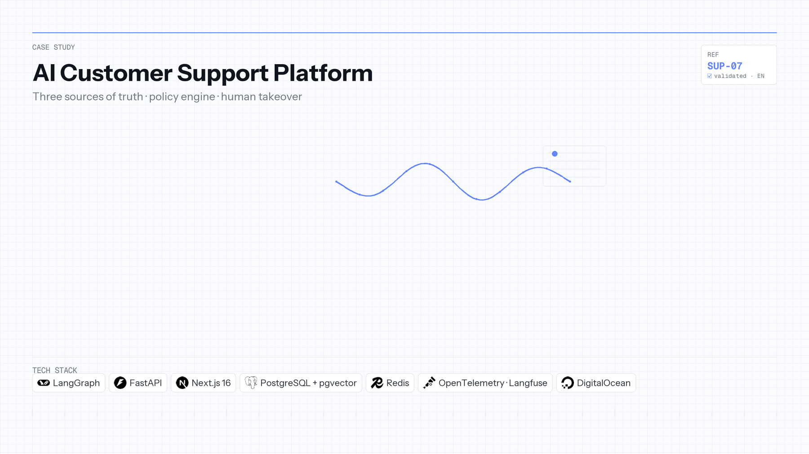

[← Back to portfolio](../README.md)

**Language:** English | [Português](ai-customer-support-platform.pt-BR.md)

# AI Customer Support Platform 🎧

**Repository:** [AI-Customer-Support-Platform-With-Langgraph](https://github.com/OtnielGomes/AI-Customer-Support-Platform-With-Langgraph)

  

| | |
|---|---|
| **Context** | Independent portfolio |
| **Timeline** | 2025 — 2026 |
| **Focus area** | Multi-agent support, policy engine & RAG |

LangGraph · FastAPI · Next.js · PostgreSQL/pgvector · Redis · Langfuse · Docker

## Overview

A support assistant that talks about orders has to be right about them. It must answer *when will my package arrive* from the actual shipment row, refuse a refund the policy does not allow, and hand the conversation to a human when automation is not authorized. An LLM asked to do this from context alone will invent order states and approve refunds it should not.

A **LangGraph supervisor** classifies intent and delegates to billing, logistics, or account workers. Three sources of truth stay separate: **PostgreSQL** for operational facts, a **deterministic policy engine** (`company.yaml`) for money and deadlines, and **RAG over pgvector** for procedures and FAQs—operational rows are deliberately excluded from the index. Tools are scoped to the authenticated customer; the **Next.js** BFF keeps API keys off the browser.

The product ships as **Customer Portal** and **Support Console** with SSE live chat, human takeover on the same thread, guardrails for jailbreak and prompt injection, and an analytics console fed by OpenTelemetry and Langfuse. Deployed on **DigitalOcean App Platform** (API, web, Postgres/pgvector, Valkey).

## Architecture

Supervisor, domain agents, facts, policy, and knowledge—without collapsing them into the prompt.

## Implementation walkthrough

### PHASE 01 — Authentication and BFF

Email-only portal login rejects unknown customers. Next.js routes chat and ticket APIs through a backend-for-frontend so secrets never reach the client.

### PHASE 02 — Guardrails and graph entry

Incoming messages pass safety checks before the LangGraph workflow runs. Failed guardrails short-circuit to refusal or escalation paths.

### PHASE 03 — Supervisor and scoped tools

The supervisor picks billing, logistics, account, or escalation workers. Tools (`get_order`, `get_payments`, `get_shipment`, `check_refund_eligibility`) are bound to the ticket’s customer ID.

### PHASE 04 — Policy vs RAG vs database

Facts come from SQL queries. Refund and threshold rules are evaluated in Python before any destructive action. RAG retrieves policy *explanations* from `data/knowledge_base/`, not live order rows.

### PHASE 05 — Live chat, takeover, and observability

Redis pub/sub fans out SSE token streams; messages persist for human pickup mid-thread. Escalation pauses automation while agents use the Support Console with tool traces. Langfuse and OpenTelemetry back intent mix, latency, and tool error dashboards.

## Tech stack deep-dive

### LangGraph

Explicit supervisor/worker graph matches how support teams think about intents and handoffs.

### Policy engine (YAML + Python)

Numbers that cost money when wrong are not negotiable in a system prompt.

### pgvector RAG

Grounds procedural answers while keeping transactional data in SQL where it belongs.

### Redis / Valkey

Cache and pub/sub for responsive chat and multi-tab console updates.

### Langfuse + OpenTelemetry

Production-grade tracing for eval harnesses (intent, tool correctness, policy compliance).

### Docker & GitHub Actions

Reproducible synthetic world (`SCN-*` anomalies) for demos and regression evals.

## Screenshots

Customer Portal — login, orders, and live chat

Email-only login. Unknown addresses are rejected; the portal never creates customers on the fly.

After sign-in the portal recognizes the customer's orders and opens a live chat from the same screen.

Routine questions — estimated delivery, payment status, items — are answered from PostgreSQL rows.

Human-in-the-loop — escalation and takeover

When automation cannot resolve the case — a payment mismatch, an identity check, a refund outside the policy window — the ticket escalates and a human continues in the same thread. The customer sees one conversation, not a handoff.

A high-value refund is not executed by the assistant. The policy engine returns the verdict, and the request goes to a person.

Support Console — inbox, takeover, and tool trail

A dark-themed console for the support team: live inbox, ticket list, and takeover.

On an escalated ticket the agent sees the transcript, the order summary, and the trail of tools the assistant already ran before taking over.

Observability — agent telemetry

Ticket volume, escalation rate, average confidence, run latency, intent mix, and per-tool error rate and p95 latency.

Security — jailbreak and prompt injection

Attempts to override the assistant's instructions are refused. It stays on policy and escalates rather than executing an unauthorized refund.

Deployment — DigitalOcean App Platform

The same stack split into separate services: FastAPI + LangGraph API, Next.js web, PostgreSQL with pgvector, Valkey for cache and chat pub/sub, and seed/ingest jobs for the synthetic data and knowledge base.

> [!NOTE]
> Setup instructions and environment variables live in the [project repository](https://github.com/OtnielGomes/AI-Customer-Support-Platform-With-Langgraph).

(<a href="#top">back to top</a>)

