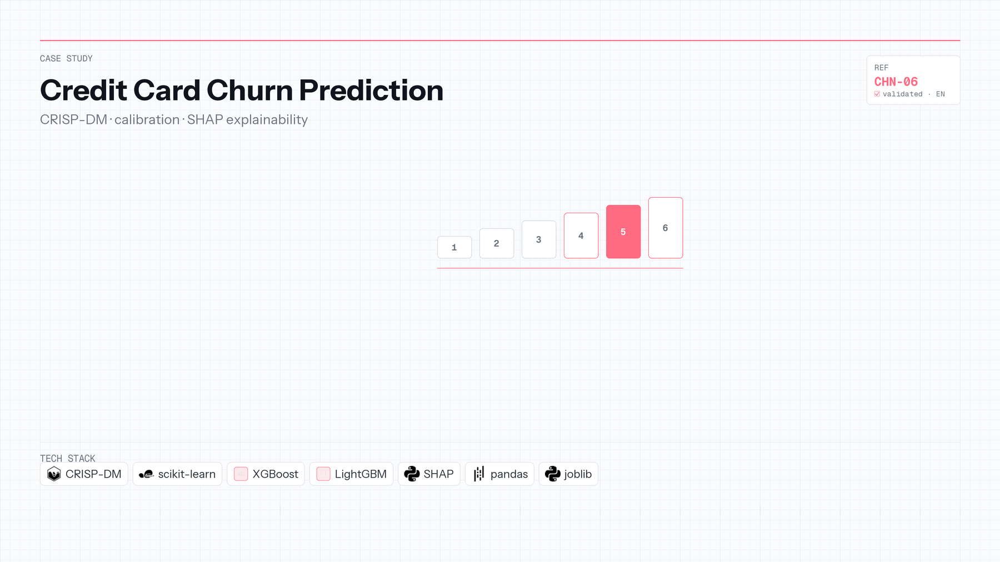

[← Back to portfolio](../README.md)

**Language:** English | [Português](churn-prediction-credit-card.pt-BR.md)

# Credit Card Churn Prediction 💳

**Repository:** [Churn-Prediction-Credit-Card](https://github.com/OtnielGomes/Churn-Prediction-Credit-Card)

  

| | |
|---|---|
| **Context** | Independent portfolio |
| **Timeline** | 2024 — 2025 |
| **Focus area** | CRISP-DM & explainable tabular ML |

scikit-learn · XGBoost · LightGBM · SHAP

## Overview

A bank loses revenue when credit-card customers churn without early warning. Marketing needs a ranked list of at-risk cardholders—not a black box that cannot be defended to compliance or the business.

An end-to-end **CRISP-DM** pipeline covers business framing, EDA, feature engineering, and comparison of Logistic Regression, SVM, KNN, Random Forest, **XGBoost**, and **LightGBM** with stratified splits and calibration analysis. The final artifact is a serialized model (`joblib`) plus SHAP explanations for why a customer scored high risk.

Deliverable: a **high-risk customer list** for targeted retention campaigns, with methodology and plots documented in the repository.

## Architecture

From business KPIs through modeling to batch scoring for CRM-style use.

## Implementation walkthrough

### PHASE 01 — Business understanding

Binary churn target, campaign lift as the success lens, and clear definition of what “churn” means in the dataset window.

### PHASE 02 — Data understanding & preparation

EDA on imbalance, correlation and chi-square tests, z-score scaling, one-hot encoding, and stratified train/test split to preserve class ratios.

### PHASE 03 — Model comparison

Train and compare classical and boosting models on validation metrics—AUC-ROC, F1, recall—and inspect calibration curves, not accuracy alone.

### PHASE 04 — Explainability & selection

SHAP values highlight drivers of churn probability for the chosen model, supporting both model selection and marketing narrative.

### PHASE 05 — Deployment artifact

Export `joblib` model and batch-scoring path that outputs the prioritized retention list (documented deployment screenshots in the repo).

## Tech stack deep-dive

### CRISP-DM structure

Shows you can run a full analytics project, not only fit one algorithm.

### XGBoost / LightGBM

Strong baselines on tabular bank-like features with efficient training on imbalanced targets.

### scikit-learn ecosystem

Linear and distance models provide interpretable anchors against complex boosters.

### SHAP

Connects model scores to per-feature contributions—expected in regulated-adjacent retail banking contexts.

### joblib artifact

Practical handoff pattern from notebook to “something CRM could schedule,” even as a portfolio simulation.

## CRISP-DM methodology

| **Stage** | **Objective** | **Methodological execution** |
| :--- | :--- | :--- |
| **1. Business Understanding** | Mitigate revenue loss by identifying at-risk customers. | • **Target definition**: Binary classification (Churn: Yes/No). • **KPIs**: Maximize **Lift** in retention campaigns & revenue saved vs. cost. |
| **2. Data Understanding** | Detect patterns of friction and dissatisfaction. | • **EDA**: Distribution analysis (detect imbalance). • **Hypothesis testing**: Correlation matrix & independence tests (Chi-Square). |
| **3. Data Preparation** | Construct a robust dataset for parametric modeling. | • **Scaling**: Standardization (Z-score). • **Encoding**: One-Hot Encoding. • **Splitting**: Stratified train/test split. |
| **4. Modeling** | Estimate churn probability. | • **Algorithms**: Logistic Regression, SVM LinearSVC, KNN, Random Forest, XGBoost, LightGBM. |
| **5. Evaluation** | Assess model reliability and financial impact. | • **Metrics**: AUC-ROC, F1-Score, Recall, calibration curve. |
| **6. Deployment** | Integrate insights into the CRM lifecycle. | • **Deliverable**: High-risk customer list for the marketing squad. • **Artifact**: Serialized model (`joblib`) for batch inference. |

## Final model — test data

  

View EDA, model comparison, and explainability

### Numerical & categorical variables

 

### Churn rate — training data

  

### Model scores on validation data

### Probability distribution & SHAP

 

 

### Correlation analysis

### Deployment artifacts

 

(<a href="#top">back to top</a>)

