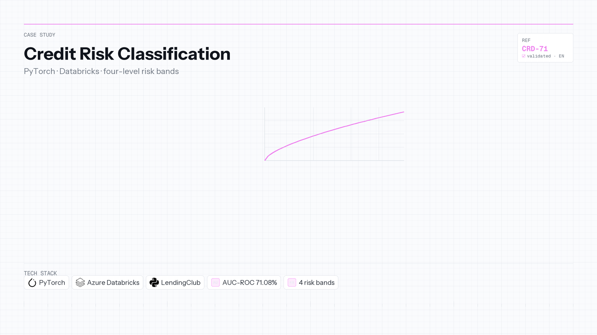

<a id="top"></a>

[← Back to portfolio](../README.md)

**Language:** English | [Português](credit-risk-classification.pt-BR.md)

# Credit Risk Classification 💸

[](https://pytorch.org/)
[](https://azure.microsoft.com/)

**Repository:** [0_Portfolio-Credit_Risk_Analysis_with_Pytorch](https://github.com/OtnielGomes/0_Portfolio-Credit_Risk_Analysis_with_Pytorch)

<div align="center">
  <a href="https://github.com/OtnielGomes/0_Portfolio-Credit_Risk_Analysis_with_Pytorch">
    
  </a>
</div>

| | |
|---|---|
| **Context** | Independent portfolio |
| **Timeline** | 2024 — 2025 |
| **Focus area** | Tabular ML & risk scoring |

PyTorch · Azure Databricks · LendingClub

## Overview

Lenders must estimate default risk at application time using only information available before approval. Wrong approvals erode margin; overly conservative denials leave revenue on the table.

A **PyTorch neural network** trains on LendingClub loan data inside **Azure Databricks**. A **four-level risk classifier** maps model scores to very low, low, medium, and very high risk bands, routing each application toward approval, conditional review, or automatic rejection with explicit business meaning per band.

On held-out test data the model reaches **71.08% AUC-ROC**, **66.42% accuracy**, and **63.87% recall**—reported with confusion-matrix and score plots in the repository for audit.


## Architecture

From raw loan features through neural scoring to policy-style risk levels.


## Implementation walkthrough

### PHASE 01 — Data sourcing and feature context

LendingClub historical loans supply labels (default vs paid) and pre-approval attributes. Exploratory work in Databricks frames which signals feed the network.

### PHASE 02 — Neural model training

PyTorch defines the feed-forward architecture, loss, and training loop on the prepared feature matrix. Training and validation run in the Databricks workspace for scalable compute.

### PHASE 03 — Evaluation on test split

Metrics include AUC-ROC, accuracy, F1, and recall on a held-out test set. Confusion matrix and score visualizations document class behavior—not just a single headline number.

### PHASE 04 — Four-level risk taxonomy

Post-model rules translate continuous risk into **very low**, **low**, **medium**, and **very high** bands with operational descriptions (rate eligibility, conditional approval, automatic reject).

### PHASE 05 — Interpretable decision output

Example classifier responses combine default probability with per-feature checks (e.g. debt-to-income, sub-grade) so a human underwriter sees *why* a band was assigned.

## Tech stack deep-dive

### PyTorch

Flexible training for tabular credit features when you outgrow sklearn baselines but stay below production deep-learning complexity.

### Azure Databricks

Managed Spark/Python environment for repeatable notebooks, data volume, and team-style ML workflows on academic portfolio scale.

### Four-level classifier

Bridges raw model scores to credit-policy language recruiters and risk teams recognize.

### LendingClub dataset

Public, well-understood benchmark for default prediction—limitations (survivorship, era) are part of honest data-science storytelling.

## Risk classification levels

| Risk level | Description |
|---|---|
| **Very low risk** | High repayment probability, eligible for lower rates |
| **Low risk** | Likely repaid, requires careful evaluation |
| **Medium risk** | Conditional approval or justified denial |
| **Very high risk** | Strong default probability — automatic rejection |

> [!NOTE]
> Per-class accuracy values in the original analysis should be verified against the [source repository](https://github.com/OtnielGomes/0_Portfolio-Credit_Risk_Analysis_with_Pytorch) — some class-level metrics share identical values and may reflect grouping rather than distinct scores.

## Test data metrics

| Metric | Value |
|---|---|
| **AUC-ROC** | 71.08% |
| **Accuracy** | 66.42% |
| **F1 Score** | 37.41% |
| **Recall** | 63.87% |

<div align="left">
  
</div>

<div align="left">
  
</div>

<details>
<summary>View example classifier output</summary>

```text
This loan has a: 46.75% chance of defaulting
Loan approved! --- Very low default risk loan

This loan has been deemed very low risk because some of the scores below meet the criteria required for loan approval.

expen_cr_inc: D >>>> Not OK
score_cr: 716.67 >>>> OK
ability_to_pay: 11.26 >>>> Not OK
dti: 27.65 >>>> Not OK

### sub_grade ###: B2 >>>> OK
```

</details>

<p align="right">(<a href="#top">back to top</a>)</p>
