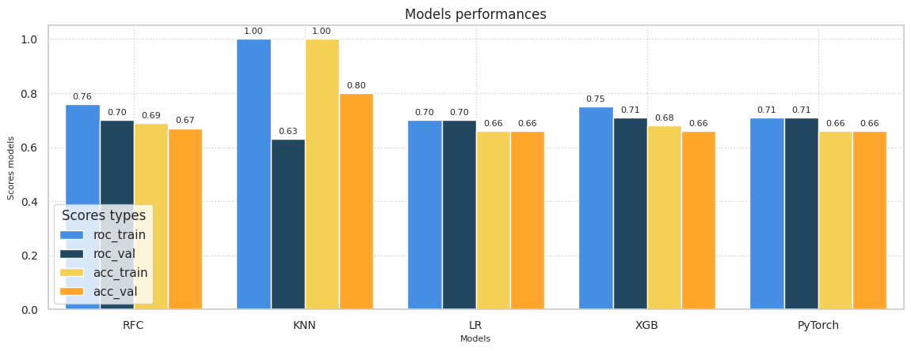
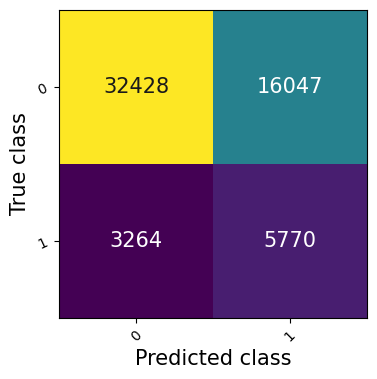

<a id="top"></a>

[← Back to portfolio](../README.md)

# Credit Risk Classification 💸

[](https://pytorch.org/)
[](https://azure.microsoft.com/)

**Repository:** [0_Portfolio-Credit_Risk_Analysis_with_Pytorch](https://github.com/OtnielGomes/0_Portfolio-Credit_Risk_Analysis_with_Pytorch)

<div align="center">
  <a href="https://github.com/OtnielGomes/0_Portfolio-Credit_Risk_Analysis_with_Pytorch">
    
  </a>
</div>

**Problem:** Lending institutions need to assess default risk at loan application time using only information available before approval.

**Solution:** A **PyTorch neural network** trained on LendingClub data in **Azure Databricks**, combined with a **4-level risk classifier** that routes loans to approval, denial, or reassessment.

**Result:** **71.08% AUC-ROC**, **66.42% accuracy**, and **63.87% recall** on test data.

## Risk classification levels

| Risk level | Description |
|---|---|
| **Very low risk** | High repayment probability, eligible for lower rates |
| **Low risk** | Likely repaid, requires careful evaluation |
| **Medium risk** | Conditional approval or justified denial |
| **Very high risk** | Strong default probability — automatic rejection |

> [!NOTE]
> Per-class accuracy values in the original analysis should be verified against the [source repository](https://github.com/OtnielGomes/0_Portfolio-Credit_Risk_Analysis_with_Pytorch) — some class-level metrics share identical values and may reflect grouping rather than distinct scores.

## Test data metrics

| Metric | Value |
|---|---|
| **AUC-ROC** | 71.08% |
| **Accuracy** | 66.42% |
| **F1 Score** | 37.41% |
| **Recall** | 63.87% |

<div align="left">
  
</div>

<div align="left">
  
</div>

<details>
<summary>View example classifier output</summary>

```text
This loan has a: 46.75% chance of defaulting
Loan approved! --- Very low default risk loan

This loan has been deemed very low risk because some of the scores below meet the criteria required for loan approval.

expen_cr_inc: D >>>> Not OK
score_cr: 716.67 >>>> OK
ability_to_pay: 11.26 >>>> Not OK
dti: 27.65 >>>> Not OK

### sub_grade ###: B2 >>>> OK
```

</details>

<p align="right">(<a href="#top">back to top</a>)</p>
