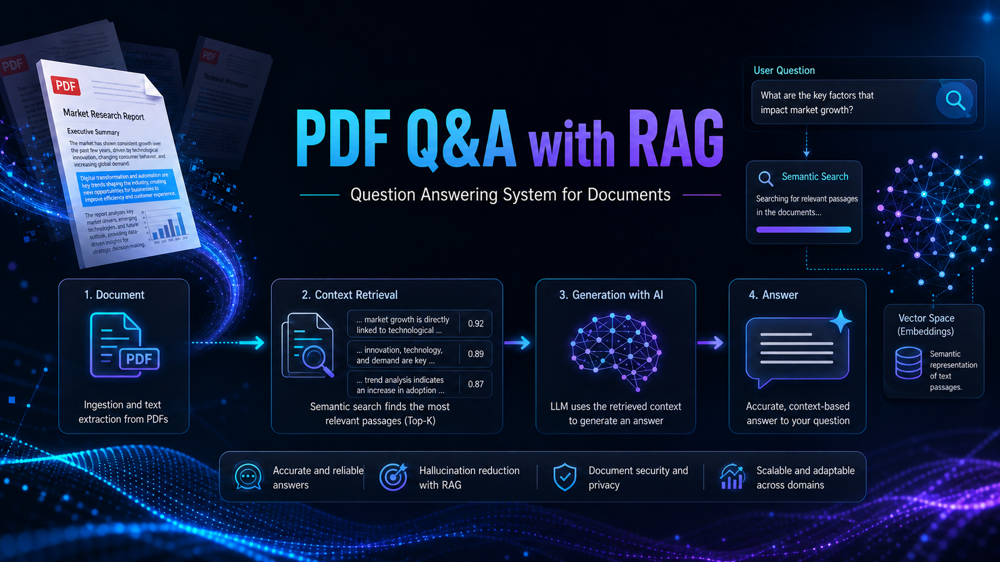
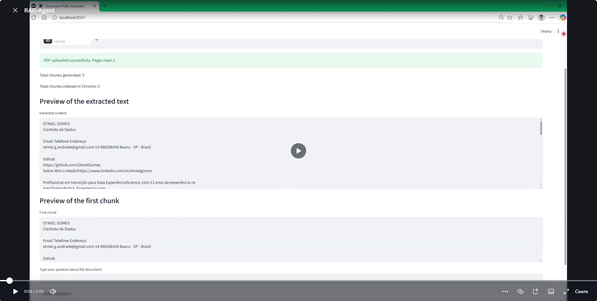
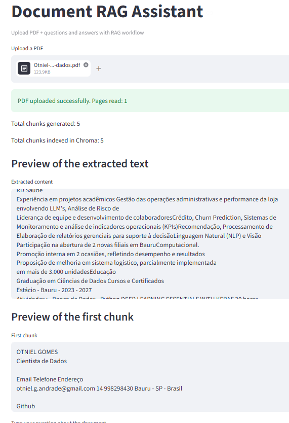
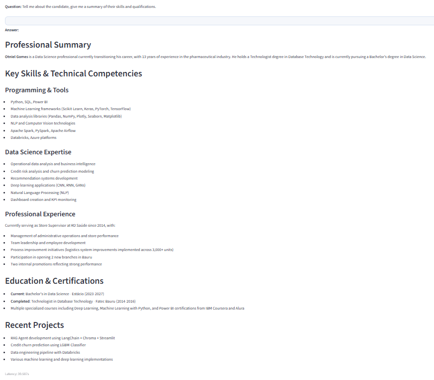
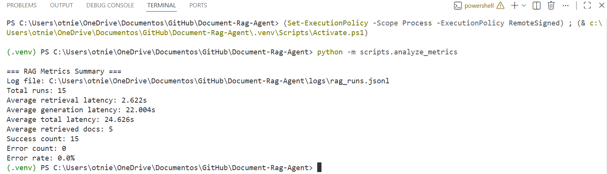

[← Back to portfolio](../README.md)

# Document RAG Agent 🗂️

**Repository:** [Document-Rag-Agent](https://github.com/OtnielGomes/Document-Rag-Agent)

  

**Problem:** Finding accurate answers inside long PDF documents is slow when relying on manual search or unconstrained LLM responses.

**Solution:** A **RAG-based Q&A system** with PDF ingestion, text chunking, semantic search via **ChromaDB**, and context-aware generation through **LangChain** and **Streamlit**, with prompt rules to reduce hallucinations.

**Result:** Grounded answers from uploaded PDFs (tested with a resume as knowledge base), with manual evaluation of accuracy and application latency.

## Architecture

| Stage | Technology | Purpose |
|---|---|---|
| Ingestion | PyMuPDF | Extract text from PDF uploads |
| Chunking & embedding | LangChain, ChromaDB | Split documents and store vectors |
| Generation | LLM via LangChain | Context-aware answer synthesis |
| Interface | Streamlit | Upload, query, and review metrics |

## Demo

View application screenshots

### Loading PDF

### Asking the agent

### Latency and metrics

(<a href="#top">back to top</a>)

