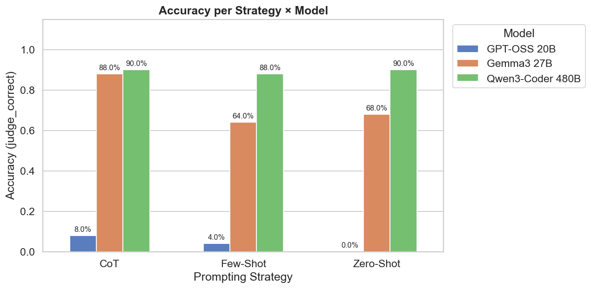
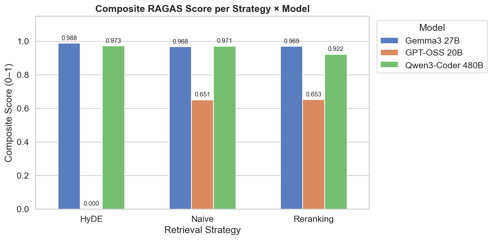
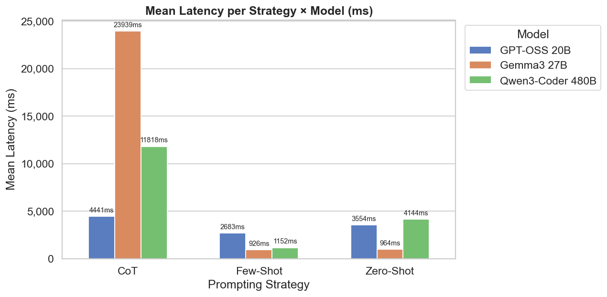
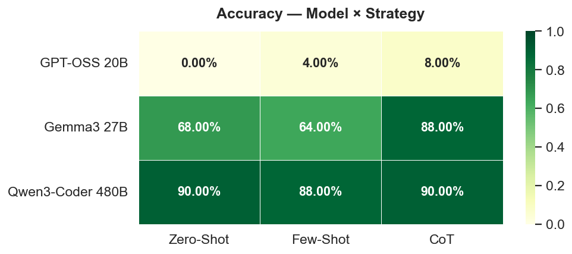
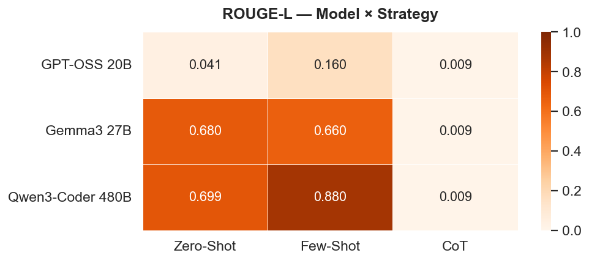
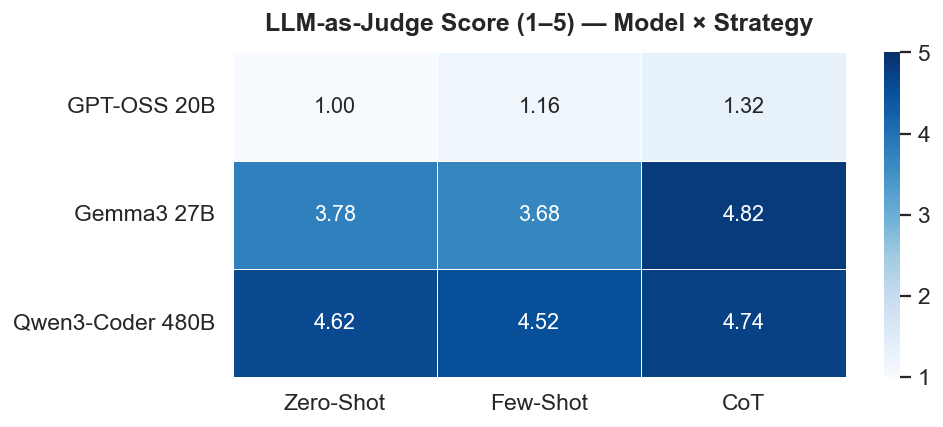
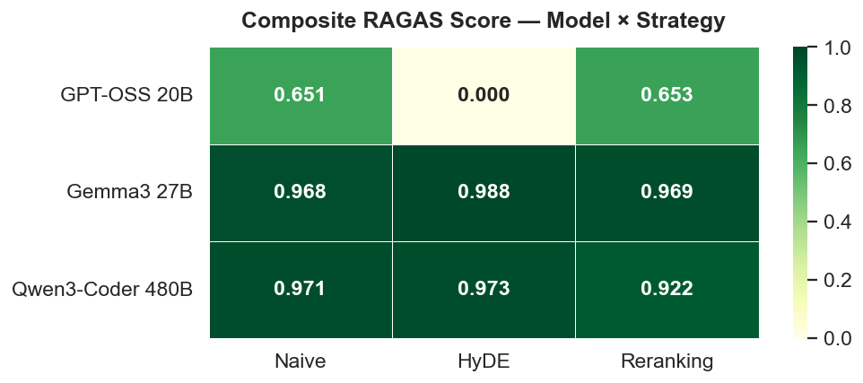
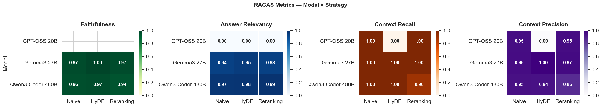
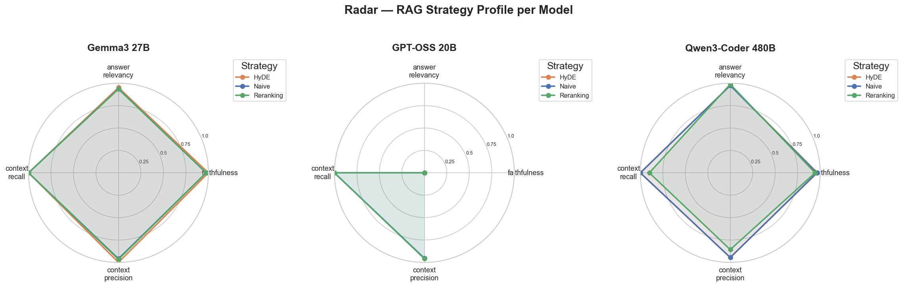
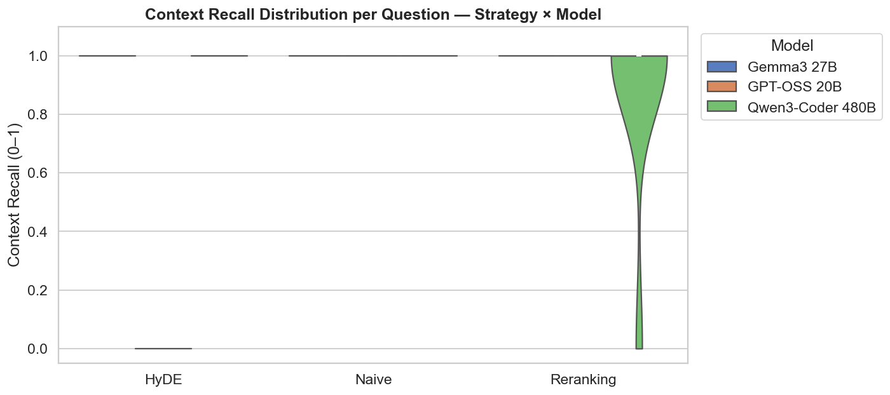

[← Back to portfolio](../README.md)

# LLM-Eval-Suite 🧪

**Repository:** [LLM-Eval-Suite](https://github.com/OtnielGomes/LLM-Eval-Suite)

  

**Problem:** Choosing the right LLM and RAG strategy requires systematic comparison — ad-hoc testing is not reproducible or measurable.

**Solution:** A benchmark framework comparing **prompting strategies** (Zero-Shot, Few-Shot, CoT) and **RAG retrieval strategies** (Naive, HyDE, Reranking) with BLEU, ROUGE, LLM-as-Judge, and RAGAS — all traced via **LangSmith**.

**Result:** **0.988** composite RAGAS score with HyDE on Gemma3 27B; **89.3%** mean accuracy with Qwen3-Coder 480B across prompting strategies.

## Architecture

| Component | Backend | Model | Purpose |
|---|---|---|---|
| Generation | Ollama Cloud | Configurable via `.env` | Answer generation |
| Embeddings | Ollama Local | `nomic-embed-text` | Document & query embeddings |
| Judge | Ollama Cloud | Configurable via `.env` | LLM-as-Judge scoring |
| Vector Store | Local | ChromaDB | Document retrieval |

## Results — Prompting accuracy

| Model | Zero-Shot | Few-Shot | CoT | Mean |
|---|---|---|---|---|
| **Qwen3-Coder 480B** | 90% | 88% | 90% | **89.3%** |
| Gemma3 27B | 68% | 64% | 88% | 73.3% |
| GPT-OSS 20B | 0% | 4% | 8% | 4% |

## Results — RAG composite RAGAS score

| Model | Naive | HyDE | Reranking | Mean |
|---|---|---|---|---|
| **Gemma3 27B** | 0.968 | **0.988** | 0.969 | **0.975** |
| Qwen3-Coder 480B | 0.971 | 0.973 | 0.922 | 0.955 |
| GPT-OSS 20B | 0.651 | 0.000 | 0.653 | 0.435 |

## Results — Latency

View detailed benchmark charts

(<a href="#top">back to top</a>)

