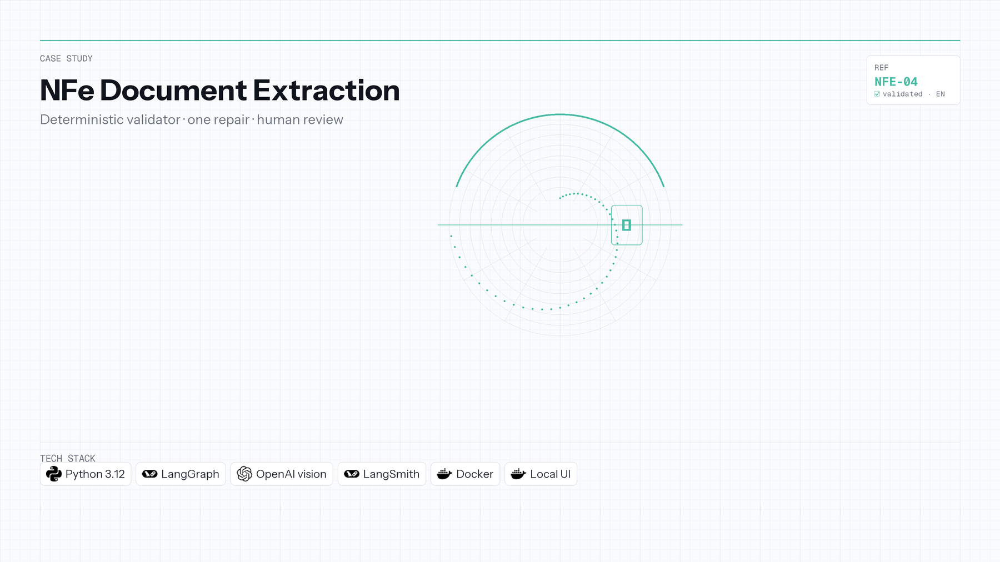

[← Back to portfolio](../README.md)

**Language:** English | [Português](nfe-document-extraction.pt-BR.md)

# NFe Document Extraction 📄

**Repository:** [NFe-Document-Extraction](https://github.com/OtnielGomes/NFe-Document-Extraction)

  

| | |
|---|---|
| **Context** | Independent portfolio |
| **Timeline** | 2025 — 2026 |
| **Focus area** | Validated inference & document AI |

Python · LangGraph · OpenAI · LangSmith · Docker

## Overview

Accounting firms and small businesses still type or check Brazilian invoices by hand. A DANFE arrives as a digital PDF or a phone photo; access key, CNPJ, line items, and totals must land in structured JSON. An LLM that reads the page is not a source of truth—a misread CNPJ digit or a total that does not add up must be caught before anyone books the invoice.

Header and line-item agents extract fields. A **deterministic validator** accepts a value only when check digits, access-key consistency, line arithmetic, totals, and formats all pass. Exactly **one repair attempt** resends failed fields with the validator’s messages. What still fails goes to **human review** with those fields flagged. Repeated retries are refused on purpose: a model that keeps adjusting numbers until arithmetic closes is inventing data that merely passes the check.

On digital PDFs, the adopted configuration reaches **0.9870** field accuracy at **US$ 0.002035** per invoice (cheap vision, `gpt-6-luna`), with planted-error detection **1.0000**. Experiments and traces live in LangSmith; quality checks run without calling a model.

## Architecture

Extraction, validation, single repair, and human review—no unbounded model retries.

## Implementation walkthrough

### PHASE 01 — Ingest and rendition

The pipeline accepts DANFE PDFs and simulated phone photos. Vision or text-layer paths feed the same schema-oriented agents depending on rendition type.

### PHASE 02 — Multi-agent extraction

Dedicated agents populate header and line-item structures. Output is provisional until the validator runs.

### PHASE 03 — Deterministic validation

Python rules enforce CNPJ check digits, NFe access-key consistency, per-line math, invoice totals, and format constraints. Failures carry machine-readable reasons for repair.

### PHASE 04 — Single repair pass

One retry sends only failing fields back to the model with validator feedback. A second failure route stops automation and flags **human review**—by design.

### PHASE 05 — Evaluation and observability

LangSmith experiments compared models and renditions; metrics (field accuracy, cost per invoice, review rate) chose the deployed configuration. Local UI supports PT/EN and visitor feedback when keys are present.

## Tech stack deep-dive

### LangGraph

Orchestrates extraction and repair as explicit graph steps instead of ad-hoc loops in application code.

### Deterministic validator (Python)

Business truth lives outside the model—the core “the model reads; the code decides if it trusts” seam.

### OpenAI vision / Responses API

Cheap vision handles photos the text layer cannot; model choice was measured, not assumed.

### LangSmith

Traces, datasets, and experiment tables make accuracy and cost auditable for recruiters and future you.

### Docker

Reproducible demo and deploy surface for the API and UI.

## How the metrics chose the design

The first pass compared four extraction approaches on a sample of 10 synthetic invoices per row. Pricing table date: **2026-10-03**. Baseline, cheap vision, and the text layer used `gpt-4.1-mini-2025-04-14`. Strong vision used `gpt-4.1-2025-04-14`. That pass kept section agents plus the deterministic validator, and kept cheap vision: it reads a simulated photo, which the text layer cannot, and it costs less than strong vision.

| Pass | Rendition | Field accuracy | Cost per invoice (USD) | Errors reaching human review |
|---|---|---:|---:|---:|
| First test, cheap vision | digital PDF | 0.9721 | 0.007105 | 9 |
| First test, cheap vision | simulated photo | 0.5736 | 0.008941 | 8 |

The second pass kept cheap vision and compared `gpt-4.1-mini-2025-04-14` with `gpt-6-luna` (Responses API, reasoning effort none). LangSmith traces and the same metrics selected `gpt-6-luna`. Pricing table date: **2026-10-08**. The adopted rows are the cheap-vision rows.

| Pass | Rendition | Field accuracy | Cost per invoice (USD) | Errors reaching human review | Planted-error detection rate |
|---|---|---:|---:|---:|---:|
| Adopted, cheap vision | digital PDF | 0.9870 | 0.002035 | 8 | 1.0000 |
| Adopted, cheap vision | simulated photo | 0.6420 | 0.002367 | 9 | 1.0000 |

On the adopted sample, digital field accuracy rose from 0.9721 to 0.9870 and cost fell from US$ 0.007105 to US$ 0.002035. Simulated-photo field accuracy rose from 0.5736 to 0.6420. The full adopted table, including the other approaches, is in the source repository.

## Screenshots

Quality checks run without calling a model. The first experiment is the smoke eval. The later charts are the configuration measured before deploy. Those shots have no language pair.

Evaluation — smoke, quality checks, and the configuration before deploy

Local interface — a clear invoice, a real DANFE, a phone photo, and feedback

The local interface is Portuguese by default, with English on the page. These shots show a clear synthetic invoice, a real DANFE, a phone photo of a real DANFE, and visitor feedback recorded in LangSmith.

(<a href="#top">back to top</a>)

(<a href="#top">back to top</a>)

