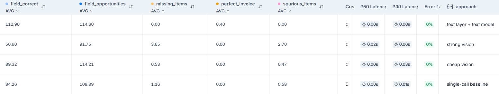
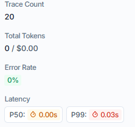
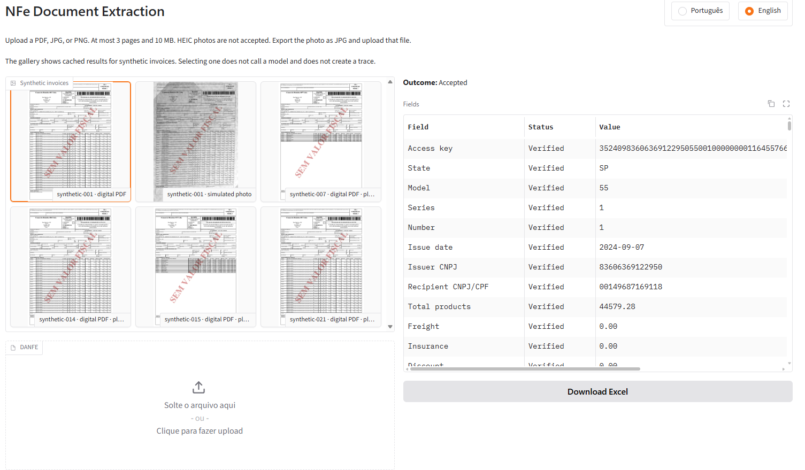
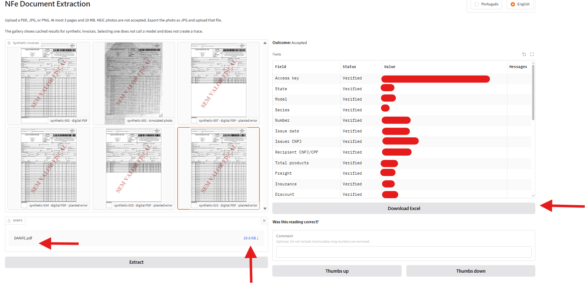
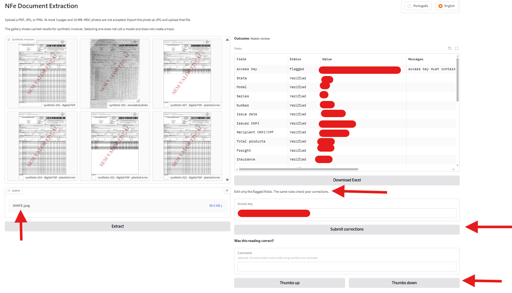
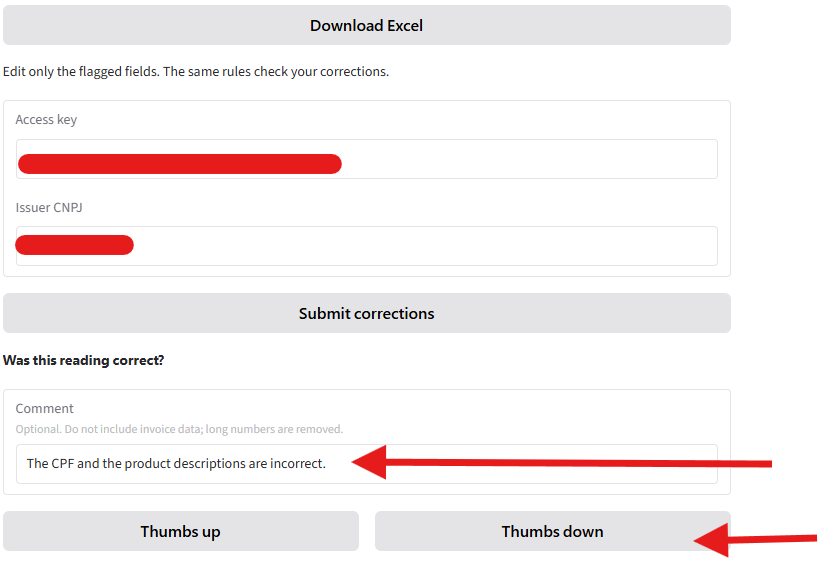
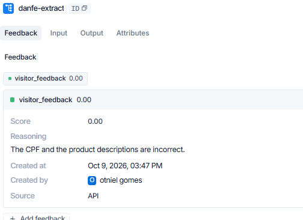

[← Voltar ao portfólio](../README.pt-BR.md)

**Idioma:** [English](nfe-document-extraction.md) | Português

# Extração de documentos NFe 📄

**Repositório:** [NFe-Document-Extraction](https://github.com/OtnielGomes/NFe-Document-Extraction)

  

| | |
|---|---|
| **Contexto** | Projeto de portfólio |
| **Linha do tempo** | 2025 — 2026 |
| **Foco** | Inferência validada e IA documental |

Python · LangGraph · OpenAI · LangSmith · Docker

## Visão geral

Escritórios e pequenos negócios ainda digitam ou conferem notas fiscais manualmente. A DANFE chega em PDF digital ou foto de celular; chave de acesso, CNPJ, itens e totais precisam virar JSON estruturado. Um LLM que “lê a página” não é fonte da verdade—um dígito errado no CNPJ ou um total que não fecha tem que ser barrado antes de lançar no ERP.

Agentes de cabeçalho e de itens extraem os campos. Um **validador determinístico** só aceita valor quando dígitos verificadores, consistência da chave, aritmética das linhas, totais e formatos passam. Há **uma única tentativa de correção**, reenviando só os campos que falharam com as mensagens do validador. O que ainda falhar vai para **revisão humana**, com esses campos sinalizados. Novas tentativas em loop são proibidas de propósito: modelo que vai ajustando número até fechar a conta está inventando dado que só passa no teste.

Em PDF digital, a configuração adotada atinge **0,9870** de acurácia por campo a **US$ 0,002035** por nota (visão barata, `gpt-6-luna`), com detecção de erro plantado em **1,0000**. Experimentos e traces ficam no LangSmith; checagens de qualidade rodam sem chamar modelo.

## Arquitetura

Extração, validação, uma correção e revisão humana—sem retentativas ilimitadas no modelo.

## Passo a passo da implementação

### FASE 01 — Entrada e tipo de mídia

O pipeline aceita DANFE em PDF e fotos simuladas. Visão ou camada de texto alimentam os mesmos agentes orientados a schema, conforme o tipo de documento.

### FASE 02 — Extração multiagente

Agentes separados preenchem cabeçalho e itens. A saída é provisória até o validador rodar.

### FASE 03 — Validação determinística

Regras em Python cobrem CNPJ, chave NFe, matemática por linha, totais e formatos. Falhas trazem motivo estruturado para a etapa de correção.

### FASE 04 — Uma passagem de correção

Um único reprocessamento manda de volta só os campos com erro e o feedback do validador. Segunda falha encerra automação e aciona **revisão humana**—por desenho.

### FASE 05 — Avaliação e observabilidade

Experimentos no LangSmith compararam modelos e mídias; métricas (acurácia por campo, custo por nota, taxa de revisão) escolheram a configuração em produção. UI local em PT/EN e feedback de visitante quando há chave configurada.

## Stack em detalhe

### LangGraph

Orquestra extração e correção como passos explícitos no grafo, em vez de loops soltos no código.

### Validador determinístico (Python)

A verdade de negócio fica fora do modelo—o núcleo de “o modelo lê; o código decide se confia”.

### OpenAI visão / Responses API

Visão barata cobre foto onde a camada de texto não chega; o modelo foi medido, não assumido.

### LangSmith

Traces, datasets e tabelas de experimento tornam acurácia e custo auditáveis.

### Docker

Superfície reproduzível para API e interface de demo.

## Como as métricas escolheram o desenho

A primeira passagem comparou quatro abordagens de extração em uma amostra de 10 notas sintéticas por linha. Data da tabela de preços: **2026-10-03**. Baseline, visão barata e camada de texto usaram `gpt-4.1-mini-2025-04-14`. Visão forte usou `gpt-4.1-2025-04-14`. Essa passagem mantém agentes por seção e o validador determinístico, e mantém visão barata: ela lê foto simulada, o que a camada de texto não cobre, e custa menos que visão forte.

| Passagem | Mídia | Acurácia de campo | Custo por nota (USD) | Erros que chegam à revisão humana |
|---|---|---:|---:|---:|
| Primeiro teste, visão barata | PDF digital | 0,9721 | 0,007105 | 9 |
| Primeiro teste, visão barata | foto simulada | 0,5736 | 0,008941 | 8 |

A segunda passagem mantém visão barata e compara `gpt-4.1-mini-2025-04-14` com `gpt-6-luna` (Responses API, reasoning effort none). Traces no LangSmith e as mesmas métricas escolheram `gpt-6-luna`. Data da tabela de preços: **2026-10-08**. As linhas adotadas são as de visão barata.

| Passagem | Mídia | Acurácia de campo | Custo por nota (USD) | Erros na revisão humana | Detecção de erro plantado |
|---|---|---:|---:|---:|---:|
| Adotada, visão barata | PDF digital | 0,9870 | 0,002035 | 8 | 1,0000 |
| Adotada, visão barata | foto simulada | 0,6420 | 0,002367 | 9 | 1,0000 |

Na amostra adotada, a acurácia em PDF digital subiu de 0,9721 para 0,9870 e o custo caiu de US$ 0,007105 para US$ 0,002035. Em foto simulada, a acurácia subiu de 0,5736 para 0,6420. A tabela completa adotada, incluindo as outras abordagens, está no repositório fonte.

## Capturas de tela

Quality checks run without calling a model. The first experiment is the smoke eval. The later charts are the configuration measured before deploy. Those shots have no language pair.

Evaluation — smoke, quality checks, and the configuration before deploy

Local interface — a clear invoice, a real DANFE, a phone photo, and feedback

The local interface is Portuguese by default, with English on the page. These shots show a clear synthetic invoice, a real DANFE, a phone photo of a real DANFE, and visitor feedback recorded in LangSmith.

(<a href="#top">back to top</a>)

(<a href="#top">back to top</a>)

(<a href="#top">voltar ao topo</a>)

