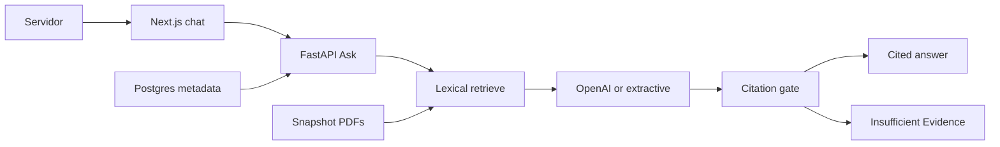
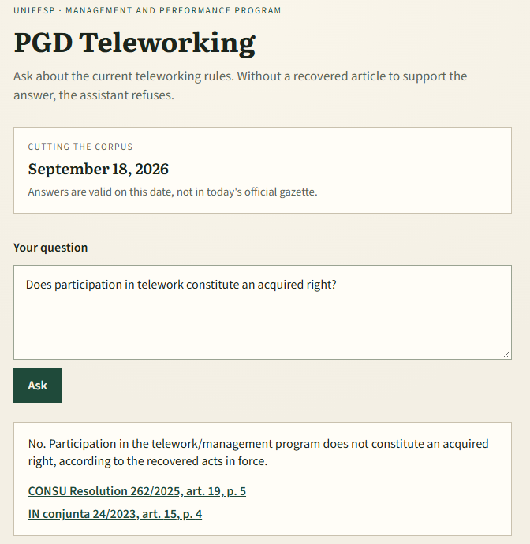
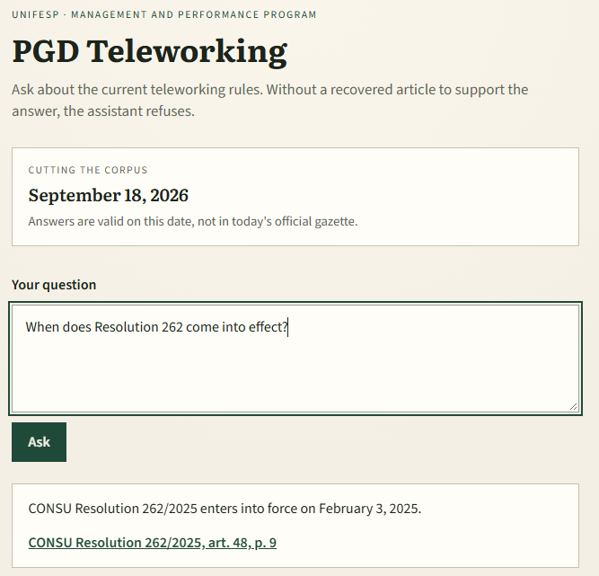
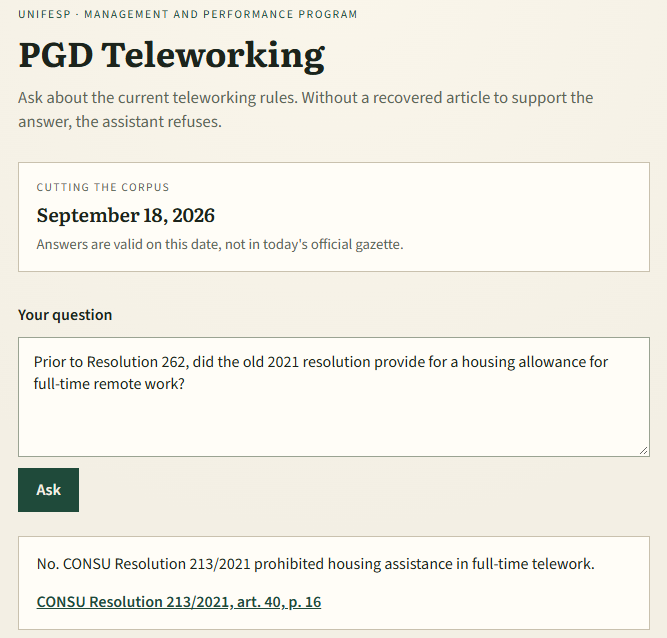
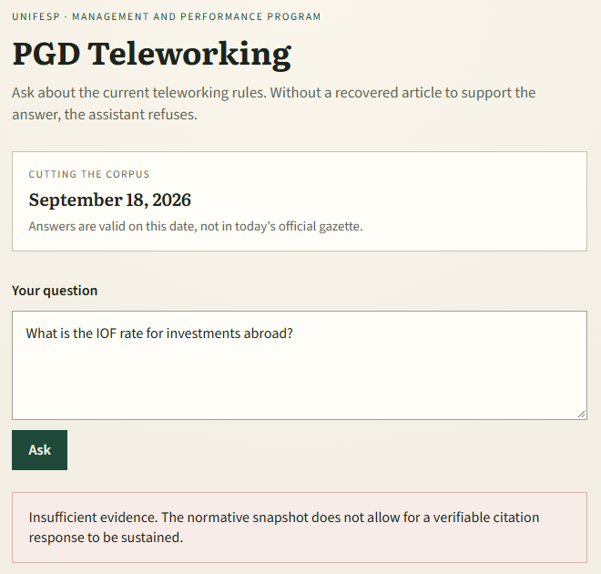
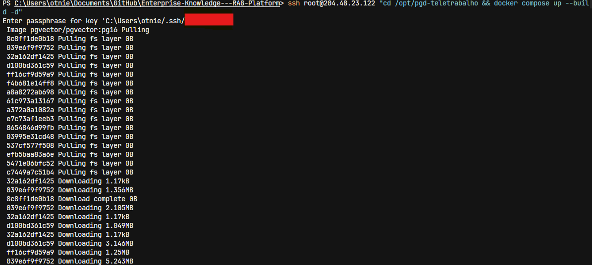
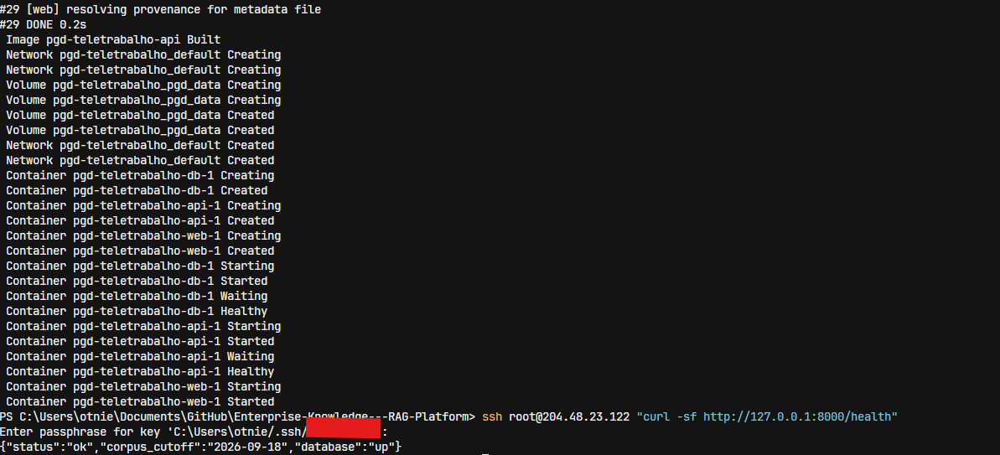
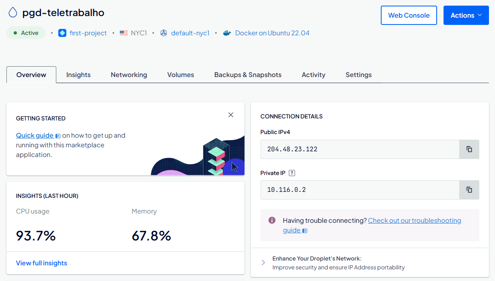
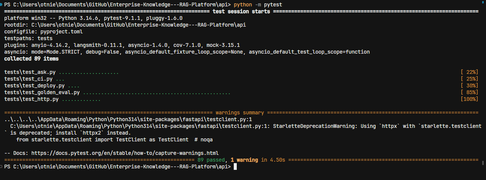

[← Back to portfolio](../README.md)

# PGD Teletrabalho 📜

**Repository:** [Enterprise-Knowledge---RAG-Platform](https://github.com/OtnielGomes/Enterprise-Knowledge---RAG-Platform)

  

The image above is the earlier framing of this repository. The case below is the Unifesp telework assistant: a dated snapshot, lexical retrieval, and a citation gate.

**Problem:** A technical-administrative servidor at Unifesp asking about telework cannot trust an unconstrained answer. The reply has to come from the normative act that is actually in force, point at an article a person can open on the PDF page, and refuse when the corpus does not support the claim. A superseded resolution must not be treated as current, and an amendment must not be silently merged into the act it changes.

**Solution:** One product seam, **Ask**. The pipeline is fixed: lexical retrieval over a dated snapshot of five numbered acts, a Portuguese draft, then a **deterministic citation gate**. Default retrieval uses Current acts. Resolução CONSU 213/2021 enters only when the question is historical. FastAPI owns Ask, Next.js is a single chat shell, and PostgreSQL holds act and article metadata. The same Compose file runs locally and on a DigitalOcean droplet.

**Result:** Every surviving claim cites an article that was retrieved, or the response is **Insufficient Evidence**. The snapshot is valid on the corpus cutoff of **18 September 2026**, not against today's gazette. **89** pytest passed with the extractive draft and an empty `OPENAI_API_KEY`, including a human-annotated golden set of **43** items scored through Ask.

## The snapshot is the source of truth

v1 is this case: one corpus, one Ask seam, citations a person can check. The repository name is leftover from an earlier framing. Leave, reimbursement, contracts, FAQ upload, live gazette crawl, login, and dashboards are out of scope.

The five PDFs are real public law, copied on **18 September 2026** from the Unifesp CONSU archive or from the federal gazette and Planalto. Ask does not invent acts.

| Normative act | Status | Role |
|---|---|---|
| Resolução CONSU 262/2025 | Current | Unifesp telework regulation in force |
| Decreto 11.072/2022 | Current | Federal PGD framework |
| IN conjunta 24/2023 | Current | Federal instruction |
| IN conjunta 21/2024 | Current | Amendment of IN 24; both stay Current |
| Resolução CONSU 213/2021 | Superseded | Historical questions only |

213 and 262 keep different numbers. They are not versions of one document. IN 21 does not replace IN 24. When both are retrieved, Ask refuses to synthesize a consolidated text and still returns citations for both. When a Unifesp act and a federal act both speak, both citations can appear.

## Architecture

| Piece | Role |
|---|---|
| FastAPI (`api/`) | Ask, snapshot ingest, retrieve, draft, citation gate |
| Next.js 15 (`web/`) | One Portuguese chat shell; proxies Ask and the PDFs |
| `snapshot/` | Five PDFs plus a manifest, copied into the API image |
| PostgreSQL 16 + pgvector | Act and article metadata |

Retrieval in v1 is **lexical overlap over articles**, not vector search. `pgvector` and an embedding model are part of the runtime slice and are not on the request path. Clicking a citation opens the PDF at that page.

### How a question is answered

1. **Retrieve.** Default candidate set is the Current acts. Historical markers add Resolução CONSU 213/2021.
2. **Draft.** `gpt-4o-mini` writes a Portuguese JSON draft. An empty `OPENAI_API_KEY`, or a failed call, falls back to an extractive draft. Retrieval and the gate do not depend on the chat model.
3. **Gate.** Deterministic. A citation survives only when its `article_id` was retrieved or its quote is in the article text. Fabricated citations are dropped. If none remain, the response is Insufficient Evidence. There is no LLM-as-judge on the request path.

## What the golden set checks

Quality is an annotator-owned golden set scored **through Ask**, not traces, RAGAS, or a model judge. The Portuguese set in `eval/golden_set.json` has **43** items, cutoff `2026-09-18`. Scoring uses the expected normative act, the expected article, and `must_abstain`.

| Category | Items | What a failure means |
|---|---:|---|
| Easy | 13 | A straight Current-slice question missed its act or article |
| Temporal, current | 7 | A date or entry-into-force question was treated as something else |
| Historical | 5 | A pre-262 question failed to allow Resolução 213/2021 |
| Unanswerable | 8 | An out-of-slice question did not abstain |
| Amendment conflict | 4 | Ask hid one of IN 24 or IN 21, or invented a consolidated rule |
| Chefia | 6 | A manager-angle question broke the same contracts; v1 has no approval workflow |

Default items fail if they treat Resolução 213/2021 as Current. A fabricated citation fails even when the prose looks right. The **89** passing tests cover that set plus the HTTP surface, the CI contract, and the Compose contract, all with the extractive draft.

## Screenshots

The running chat is Portuguese only. The English shots below document the same flows.

How it answers — current, historical, and refusal

A question about a rule in force is answered from Current acts. Here both a Unifesp act and a federal instruction speak, so both citations survive: participation in telework is not an acquired right.

Questions about when an act entered into force stay on the Current slice. The cutoff is the snapshot date, not today. Resolution 262 comes into effect on 3 February 2025.

A historical question is the only case in which the superseded Resolução CONSU 213/2021 may be cited.

Questions outside the snapshot are refused. The assistant does not guess.

Deployment — the same Compose file on a droplet

The droplet runs the same `compose.yaml` as local development. PostgreSQL and Ask listen on localhost; the chat is the published port.

Tests — golden set through Ask

`pytest` in `api/` collected **89** tests and passed all of them with the extractive draft and an empty API key. CI runs that same suite: no OpenAI secret, no Langfuse, no RAGAS.

> [!NOTE]
> Setup, environment variables, and the deploy script live in the [project repository](https://github.com/OtnielGomes/Enterprise-Knowledge---RAG-Platform), which also has a [Portuguese README](https://github.com/OtnielGomes/Enterprise-Knowledge---RAG-Platform/blob/main/README.pt-BR.md).

(<a href="#top">back to top</a>)

