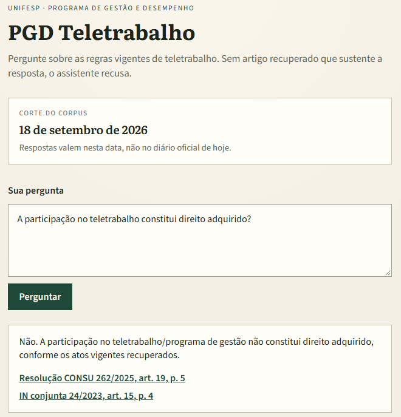
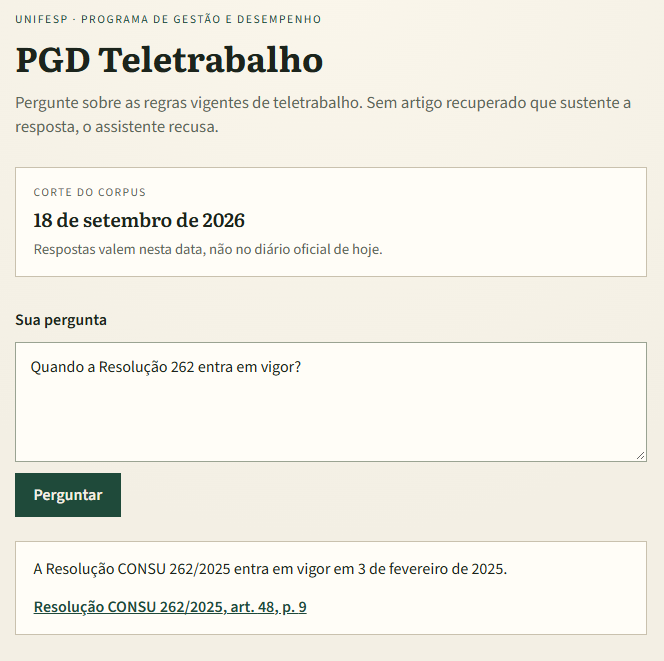
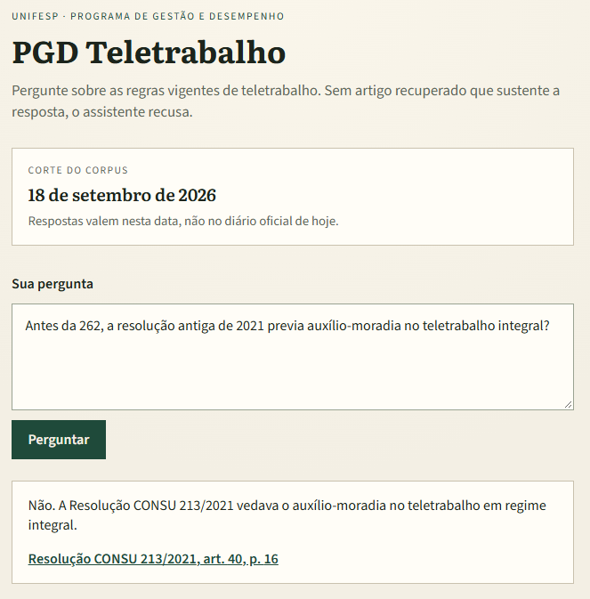
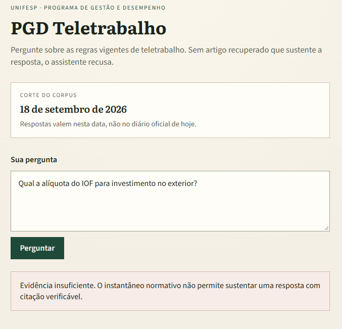

[← Voltar ao portfólio](../README.pt-BR.md)

**Idioma:** [English](pgd-teletrabalho.md) | Português

# PGD Teletrabalho 📜

**Repositório:** [Enterprise-Knowledge---RAG-Platform](https://github.com/OtnielGomes/Enterprise-Knowledge---RAG-Platform)

  

RAG-Platform
imageDir: pgd-teletrabalho
tech:
  - Python
  - FastAPI
  - Next.js
  - PostgreSQL
  - Docker
  - pytest
---

# Assistente PGD Teletrabalho (Unifesp)

| | |
|---|---|
| **Contexto** | Projeto de portfólio |
| **Linha do tempo** | 2025 — 2026 |
| **Foco** | Citation gate e RAG normativo |

Python · FastAPI · Next.js · PostgreSQL · Docker · pytest

## Visão geral

Servidor técnico-administrativo da Unifesp que pergunta sobre teletrabalho não pode confiar em resposta solta. A resposta precisa citar o ato normativo vigente, apontar artigo abrível no PDF e recusar quando o corpus não sustenta a afirmação. Ato revogado não pode parecer vigente; alteração não pode ser fundida em silêncio no ato que modifica.

Um único fluxo de produto, **Ask**: recuperação lexical sobre snapshot datado de cinco atos numerados, rascunho em português e **citation gate determinístico**. Por padrão só entram atos **Vigentes**; Resolução CONSU 213/2021 só em perguntas históricas. FastAPI concentra o Ask, Next.js é um chat único, PostgreSQL guarda metadados de atos e artigos. O mesmo `compose.yaml` roda local e em droplet na DigitalOcean.

Cada afirmação que sobrevive cita artigo recuperado, ou a resposta é **Evidência Insuficiente**. Corte do corpus: **18 de setembro de 2026**. **89** testes pytest passam com rascunho extrativo e `OPENAI_API_KEY` vazia, incluindo golden set de **43** itens avaliados pelo Ask.

## Arquitetura

PDFs do snapshot, recuperação lexical, rascunho e gate de citação—sem juiz LLM no caminho da requisição.

## Passo a passo da implementação

### FASE 01 — Ingestão do snapshot e metadados

Cinco PDFs públicos (CONSU 262/2025, normas federais, 213/2021 revogada) entram na imagem da API com manifesto. O PostgreSQL registra status (Vigente vs Revogado) e texto dos artigos para busca e validação.

### FASE 02 — Recuperação lexical

O conjunto padrão são só atos vigentes. Marcadores históricos incluem 213/2021. A v1 usa sobreposição lexical em artigos—busca vetorial não está no caminho quente.

### FASE 03 — Geração do rascunho

`gpt-4o-mini` produz rascunho JSON em português quando há chave. Chave vazia ou falha de API cai no rascunho extrativo. Recuperação e gate não dependem do modelo de chat.

### FASE 04 — Citation gate determinístico

A citação só permanece se o `article_id` foi recuperado ou a citação literal está no texto do artigo. Citações fabricadas caem. Sem citações válidas, a API devolve Evidência Insuficiente—sem LLM-as-judge.

### FASE 05 — Testes, CI e deploy

Categorias do golden set (temporal, histórico, sem resposta, conflito de alteração) passam pelo Ask. A CI roda os mesmos **89** testes sem segredo OpenAI. Produção usa o mesmo `compose.yaml` do ambiente local.

## Stack em detalhe

### FastAPI (API Ask)

Um único seam retrieve → rascunho → gate torna o contrato testável de ponta a ponta.

### Recuperação lexical

Comportamento previsível em fatia jurídica pequena e versionada antes de apostar em embeddings sem eval.

### Citation gate (Python)

Confiança é código; o modelo só propõe texto e citações a verificar.

### Shell Next.js

Chat em português faz proxy do Ask e abre PDF na página citada.

### PostgreSQL + pgvector (fatia de runtime)

Metadados hoje; pgvector está no stack mas fora do caminho da v1.

### Docker Compose

Paridade local e droplet—um arquivo, health checks, data de corte visível em operação.

## Capturas de tela

O chat em execução é em português. As capturas abaixo documentam os mesmos fluxos.

How it answers — current, historical, and refusal

A question about a rule in force is answered from Current acts. Here both a Unifesp act and a federal instruction speak, so both citations survive: participation in telework is not an acquired right.

Questions about when an act entered into force stay on the Current slice. The cutoff is the snapshot date, not today. Resolution 262 comes into effect on 3 February 2025.

A historical question is the only case in which the superseded Resolução CONSU 213/2021 may be cited.

Questions outside the snapshot are refused. The assistant does not guess.

Deployment — the same Compose file on a droplet

The droplet runs the same `compose.yaml` as local development. PostgreSQL and Ask listen on localhost; the chat is the published port.

Tests — golden set through Ask

`pytest` in `api/` collected **89** tests and passed all of them with the extractive draft and an empty API key. CI runs that same suite: no OpenAI secret, no Langfuse, no RAGAS.

> [!NOTE]
> Instruções de setup e variáveis de ambiente estão no [repositório do projeto](https://github.com/OtnielGomes/Enterprise-Knowledge---RAG-Platform).

(<a href="#top">voltar ao topo</a>)

