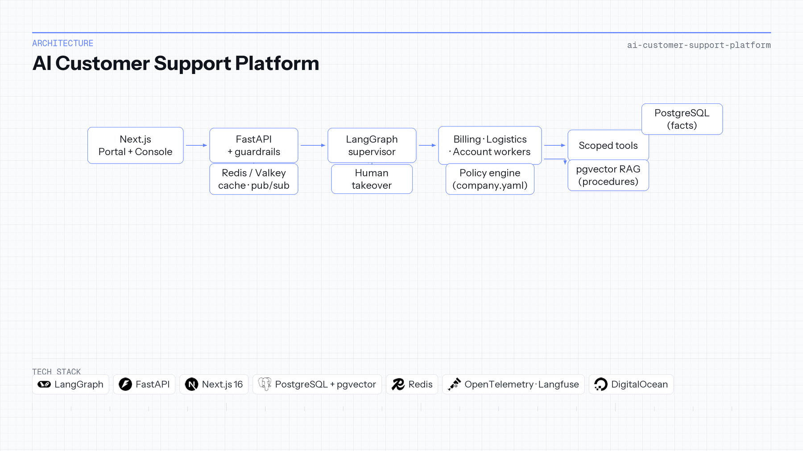

# AI Customer Support Platform

| | |
|---|---|
| **Context** | Independent portfolio |
| **Timeline** | 2025 — 2026 |
| **Focus area** | Multi-agent support, policy engine & RAG |

LangGraph · FastAPI · Next.js · PostgreSQL/pgvector · Redis · Langfuse · Docker

## Overview

A support assistant that talks about orders has to be right about them. It must answer *when will my package arrive* from the actual shipment row, refuse a refund the policy does not allow, and hand the conversation to a human when automation is not authorized. An LLM asked to do this from context alone will invent order states and approve refunds it should not.

A **LangGraph supervisor** classifies intent and delegates to billing, logistics, or account workers. Three sources of truth stay separate: **PostgreSQL** for operational facts, a **deterministic policy engine** (`company.yaml`) for money and deadlines, and **RAG over pgvector** for procedures and FAQs—operational rows are deliberately excluded from the index. Tools are scoped to the authenticated customer; the **Next.js** BFF keeps API keys off the browser.

The product ships as **Customer Portal** and **Support Console** with SSE live chat, human takeover on the same thread, guardrails for jailbreak and prompt injection, and an analytics console fed by OpenTelemetry and Langfuse. Deployed on **DigitalOcean App Platform** (API, web, Postgres/pgvector, Valkey).

**Repository:** [AI-Customer-Support-Platform-With-Langgraph](https://github.com/OtnielGomes/AI-Customer-Support-Platform-With-Langgraph)

## Architecture

Supervisor, domain agents, facts, policy, and knowledge—without collapsing them into the prompt.

## Implementation walkthrough

### PHASE 01 — Authentication and BFF

Email-only portal login rejects unknown customers. Next.js routes chat and ticket APIs through a backend-for-frontend so secrets never reach the client.

### PHASE 02 — Guardrails and graph entry

Incoming messages pass safety checks before the LangGraph workflow runs. Failed guardrails short-circuit to refusal or escalation paths.

### PHASE 03 — Supervisor and scoped tools

The supervisor picks billing, logistics, account, or escalation workers. Tools (`get_order`, `get_payments`, `get_shipment`, `check_refund_eligibility`) are bound to the ticket’s customer ID.

### PHASE 04 — Policy vs RAG vs database

Facts come from SQL queries. Refund and threshold rules are evaluated in Python before any destructive action. RAG retrieves policy *explanations* from `data/knowledge_base/`, not live order rows.

### PHASE 05 — Live chat, takeover, and observability

Redis pub/sub fans out SSE token streams; messages persist for human pickup mid-thread. Escalation pauses automation while agents use the Support Console with tool traces. Langfuse and OpenTelemetry back intent mix, latency, and tool error dashboards.

## Tech stack deep-dive

### LangGraph

Explicit supervisor/worker graph matches how support teams think about intents and handoffs.

### Policy engine (YAML + Python)

Numbers that cost money when wrong are not negotiable in a system prompt.

### pgvector RAG

Grounds procedural answers while keeping transactional data in SQL where it belongs.

### Redis / Valkey

Cache and pub/sub for responsive chat and multi-tab console updates.

### Langfuse + OpenTelemetry

Production-grade tracing for eval harnesses (intent, tool correctness, policy compliance).

### Docker & GitHub Actions

Reproducible synthetic world (`SCN-*` anomalies) for demos and regression evals.
