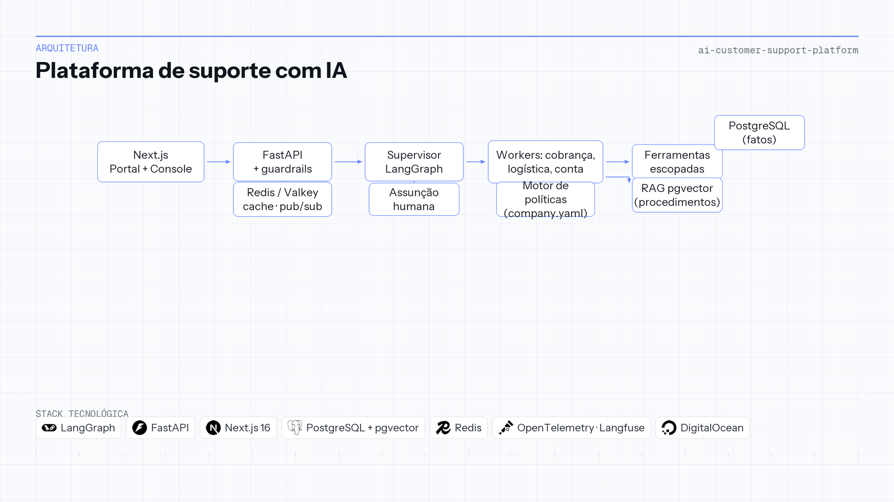

# Plataforma de suporte com IA

| | |
|---|---|
| **Contexto** | Projeto de portfólio |
| **Linha do tempo** | 2025 — 2026 |
| **Foco** | Multiagente, motor de políticas e RAG |

LangGraph · FastAPI · Next.js · PostgreSQL/pgvector · Redis · Langfuse · Docker

## Visão geral

Um assistente de suporte que fala de pedidos precisa acertar os fatos. Tem que responder *quando chega meu pacote* a partir da linha real de envio, negar reembolso fora da política e passar a conversa para um humano quando a automação não tem mandato. Um LLM que improvisa só com contexto inventa status de pedido e aprova reembolsos indevidos.

Um **supervisor LangGraph** classifica a intenção e delega a workers de cobrança, logística ou conta. Três fontes da verdade permanecem separadas: **PostgreSQL** para fatos operacionais, **motor de políticas determinístico** (`company.yaml`) para dinheiro e prazos, e **RAG em pgvector** para procedimentos e FAQ—linhas operacionais ficam de fora do índice de propósito. Ferramentas respeitam o cliente autenticado; o BFF **Next.js** impede que chaves de API cheguem ao navegador.

O produto entrega **Portal do Cliente** e **Console de Suporte** com chat ao vivo via SSE, takeover humano na mesma thread, guardrails contra jailbreak e injeção de prompt, e console analítico com OpenTelemetry e Langfuse. Deploy no **DigitalOcean App Platform** (API, web, Postgres/pgvector, Valkey).

**Repositório:** [AI-Customer-Support-Platform-With-Langgraph](https://github.com/OtnielGomes/AI-Customer-Support-Platform-With-Langgraph)

## Arquitetura

Supervisor, agentes de domínio, fatos, política e conhecimento—sem colapsar tudo no prompt.

## Passo a passo da implementação

### FASE 01 — Autenticação e BFF

Login só por e-mail no portal; endereços desconhecidos são rejeitados. O Next.js encaminha chat e tickets por um backend-for-frontend, sem expor segredos no cliente.

### FASE 02 — Guardrails e entrada no grafo

Mensagens passam por checagens de segurança antes do workflow LangGraph. Falhas desviam para recusa ou escalonamento.

### FASE 03 — Supervisor e ferramentas com escopo

O supervisor escolhe cobrança, logística, conta ou escalonamento. Ferramentas (`get_order`, `get_payments`, `get_shipment`, `check_refund_eligibility`) ficam amarradas ao ID do cliente do ticket.

### FASE 04 — Política, RAG e banco

Fatos vêm de consultas SQL. Regras de reembolso e limites em BRL são avaliadas em Python antes de qualquer ação destrutiva. O RAG busca *explicações* de política em `data/knowledge_base/`, não linhas vivas de pedido.

### FASE 05 — Chat ao vivo, takeover e observabilidade

Redis pub/sub distribui tokens SSE; mensagens persistem para um humano assumir no meio da thread. Escalonamento pausa a automação enquanto o console mostra o rastro de ferramentas. Langfuse e OpenTelemetry alimentam dashboards de intenção, latência e erro por tool.

## Stack em detalhe

### LangGraph

Grafo supervisor/worker espelha como times de suporte pensam intenção e repasse.

### Motor de políticas (YAML + Python)

Valores que custam dinheiro se errados não são negociáveis em prompt de sistema.

### RAG com pgvector

Responde procedimento mantendo dado transacional no SQL.

### Redis / Valkey

Cache e pub/sub para chat responsivo e console em tempo real.

### Langfuse + OpenTelemetry

Tracing de produção para evals (intenção, chamada de tool, conformidade com política).

### Docker e GitHub Actions

Mundo sintético reproduzível (anomalias `SCN-*`) para demo e regressão.
