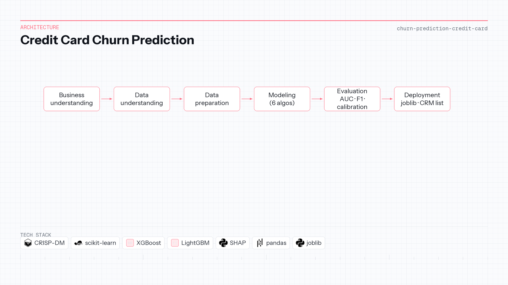

# Credit Card Churn Prediction

| | |
|---|---|
| **Context** | Independent portfolio |
| **Timeline** | 2024 — 2025 |
| **Focus area** | CRISP-DM & explainable tabular ML |

scikit-learn · XGBoost · LightGBM · SHAP

## Overview

A bank loses revenue when credit-card customers churn without early warning. Marketing needs a ranked list of at-risk cardholders—not a black box that cannot be defended to compliance or the business.

An end-to-end **CRISP-DM** pipeline covers business framing, EDA, feature engineering, and comparison of Logistic Regression, SVM, KNN, Random Forest, **XGBoost**, and **LightGBM** with stratified splits and calibration analysis. The final artifact is a serialized model (`joblib`) plus SHAP explanations for why a customer scored high risk.

Deliverable: a **high-risk customer list** for targeted retention campaigns, with methodology and plots documented in the repository.

**Repository:** [Churn-Prediction-Credit-Card](https://github.com/OtnielGomes/Churn-Prediction-Credit-Card)

## Architecture

From business KPIs through modeling to batch scoring for CRM-style use.

## Implementation walkthrough

### PHASE 01 — Business understanding

Binary churn target, campaign lift as the success lens, and clear definition of what “churn” means in the dataset window.

### PHASE 02 — Data understanding & preparation

EDA on imbalance, correlation and chi-square tests, z-score scaling, one-hot encoding, and stratified train/test split to preserve class ratios.

### PHASE 03 — Model comparison

Train and compare classical and boosting models on validation metrics—AUC-ROC, F1, recall—and inspect calibration curves, not accuracy alone.

### PHASE 04 — Explainability & selection

SHAP values highlight drivers of churn probability for the chosen model, supporting both model selection and marketing narrative.

### PHASE 05 — Deployment artifact

Export `joblib` model and batch-scoring path that outputs the prioritized retention list (documented deployment screenshots in the repo).

## Tech stack deep-dive

### CRISP-DM structure

Shows you can run a full analytics project, not only fit one algorithm.

### XGBoost / LightGBM

Strong baselines on tabular bank-like features with efficient training on imbalanced targets.

### scikit-learn ecosystem

Linear and distance models provide interpretable anchors against complex boosters.

### SHAP

Connects model scores to per-feature contributions—expected in regulated-adjacent retail banking contexts.

### joblib artifact

Practical handoff pattern from notebook to “something CRM could schedule,” even as a portfolio simulation.
