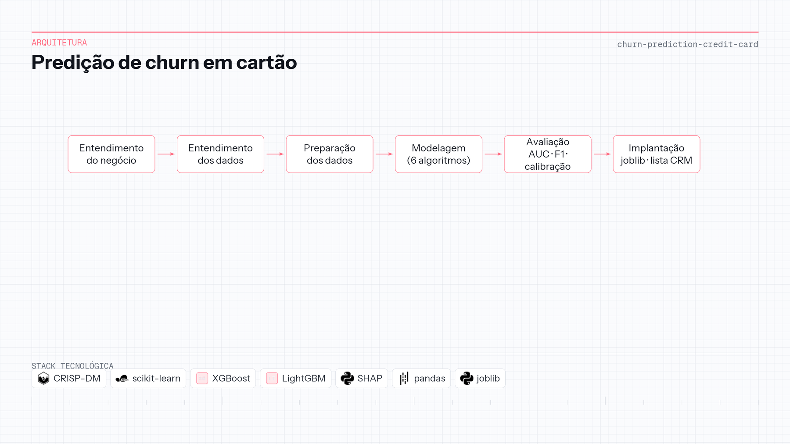

# Previsão de churn em cartão de crédito

| | |
|---|---|
| **Contexto** | Projeto de portfólio |
| **Linha do tempo** | 2024 — 2025 |
| **Foco** | CRISP-DM e ML tabular explicável |

scikit-learn · XGBoost · LightGBM · SHAP

## Visão geral

O banco perde receita quando clientes de cartão cancelam sem alerta antecipado. Marketing precisa de uma lista ranqueada de risco—nota de caixa-preta que compliance e negócio não aceitam.

Um pipeline **CRISP-DM** de ponta a ponta cobre entendimento do negócio, EDA, engenharia de features e comparação de Regressão Logística, SVM, KNN, Random Forest, **XGBoost** e **LightGBM**, com divisão estratificada e análise de calibração. O artefato final é modelo serializado (`joblib`) e explicações SHAP do porquê de um cliente estar em alto risco.

Entregável: **lista de clientes de alto risco** para campanhas de retenção, com metodologia e gráficos no repositório.

**Repositório:** [Churn-Prediction-Credit-Card](https://github.com/OtnielGomes/Churn-Prediction-Credit-Card)

## Arquitetura

Dos KPIs de negócio ao modelo e à pontuação em lote para uso tipo CRM.

## Passo a passo da implementação

### FASE 01 — Entendimento do negócio

Target binário de churn, lift de campanha como métrica de sucesso e definição clara de cancelamento na janela do dataset.

### FASE 02 — Entendimento e preparação dos dados

EDA de desbalanceamento, correlação e qui-quadrado, padronização z-score, one-hot e split estratificado preservando proporção de classes.

### FASE 03 — Comparação de modelos

Treino e comparação de modelos clássicos e boosting na validação—AUC-ROC, F1, recall—com curvas de calibração, não só acurácia.

### FASE 04 — Explicabilidade e escolha

SHAP destaca drivers da probabilidade de churn no modelo escolhido, apoiando seleção e narrativa para marketing.

### FASE 05 — Artefato de deploy

Exportação em `joblib` e caminho de scoring em lote que gera a lista priorizada (screenshots de deploy documentados no repo).

## Stack em detalhe

### Estrutura CRISP-DM

Mostra capacidade de conduzir projeto analítico completo, não só um algoritmo.

### XGBoost / LightGBM

Baselines fortes em features tabulares “de banco”, com treino eficiente em target desbalanceado.

### Ecossistema scikit-learn

Modelos lineares e por distância dão âncora interpretável frente aos boosters.

### SHAP

Liga score a contribuição por feature—esperado em contextos próximos a banco e compliance.

### Artefato joblib

Padrão prático de handoff do notebook para algo que o CRM poderia agendar, mesmo como simulação de portfólio.
