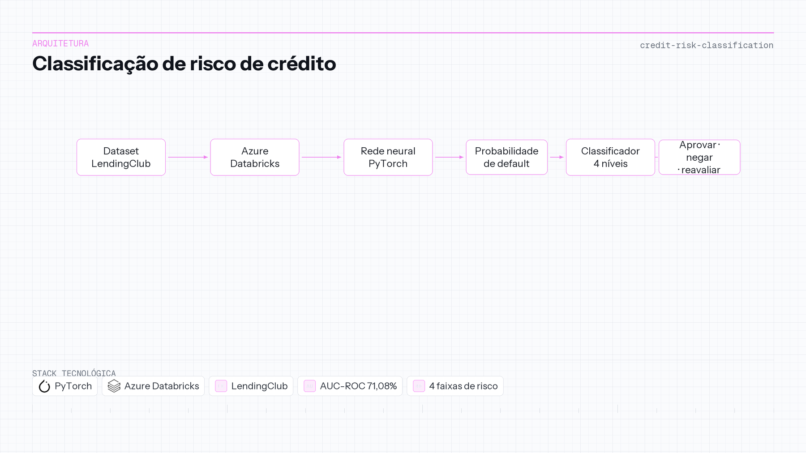

# Classificação de risco de crédito

| | |
|---|---|
| **Contexto** | Projeto de portfólio |
| **Linha do tempo** | 2024 — 2025 |
| **Foco** | ML tabular e score de risco |

PyTorch · Azure Databricks · LendingClub

## Visão geral

Instituições precisam estimar risco de inadimplência no momento da proposta, só com informação disponível antes da aprovação. Aprovar demais corrói margem; negar em excesso deixa receita na mesa.

Uma **rede neural PyTorch** treina em empréstimos LendingClub no **Azure Databricks**. Um **classificador em quatro níveis** mapeia o score do modelo para faixas de risco muito baixo, baixo, médio e muito alto, orientando aprovação, análise condicional ou rejeição automática com significado de negócio explícito por faixa.

No conjunto de teste o modelo atinge **71,08% de AUC-ROC**, **66,42% de acurácia** e **63,87% de recall**—com matriz de confusão e gráficos de score no repositório para auditoria.

**Repositório:** [0_Portfolio-Credit_Risk_Analysis_with_Pytorch](https://github.com/OtnielGomes/0_Portfolio-Credit_Risk_Analysis_with_Pytorch)

## Arquitetura

Das features de empréstimo ao score neural e às faixas de risco operacionais.

## Passo a passo da implementação

### FASE 01 — Dados e contexto de features

Empréstimos históricos LendingClub trazem label (default vs quitado) e atributos pré-aprovação. Exploração no Databricks define quais sinais entram na rede.

### FASE 02 — Treino da rede neural

PyTorch define arquitetura feed-forward, função de perda e loop de treino na matriz preparada. Treino e validação rodam no workspace Databricks.

### FASE 03 — Avaliação no teste

Métricas incluem AUC-ROC, acurácia, F1 e recall em hold-out. Matriz de confusão e visualizações de score documentam comportamento por classe—nota única não basta.

### FASE 04 — Taxonomia de quatro níveis

Regras pós-modelo traduzem risco contínuo em faixas **muito baixo**, **baixo**, **médio** e **muito alto**, com descrição operacional (taxa, aprovação condicional, rejeição automática).

### FASE 05 — Saída interpretável

Exemplos de resposta do classificador combinam probabilidade de default com checagens por feature (DTI, sub-grade etc.) para o analista ver *por que* a faixa foi atribuída.

## Stack em detalhe

### PyTorch

Treino flexível em features tabulares de crédito quando baselines sklearn ficam curtos, sem complexidade de deep learning em produção.

### Azure Databricks

Ambiente Spark/Python gerenciado para notebooks reproduzíveis e volume de dados em escala de portfólio acadêmico.

### Classificador em quatro níveis

Ponte entre score bruto e linguagem de política de crédito que risco e recrutamento reconhecem.

### Dataset LendingClub

Benchmark público de default—limitações (viés de época, survivorship) entram na narrativa honesta de ciência de dados.
