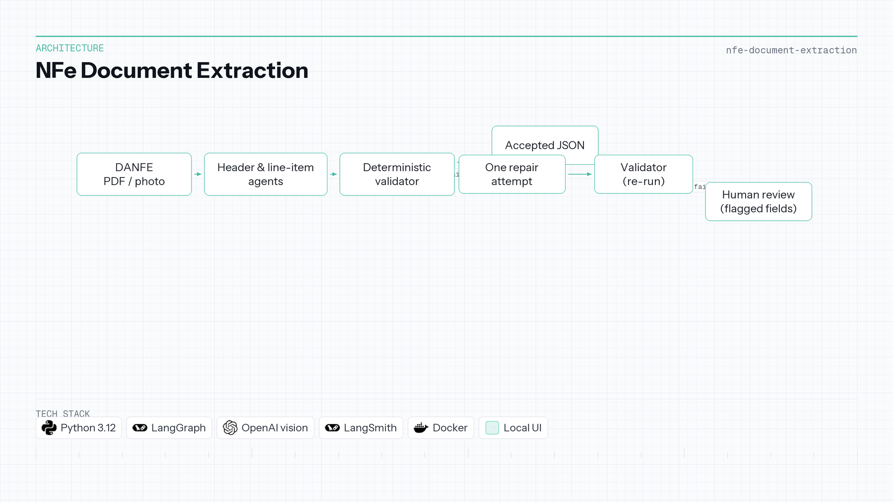

# NFe Document Extraction

| | |
|---|---|
| **Context** | Independent portfolio |
| **Timeline** | 2025 — 2026 |
| **Focus area** | Validated inference & document AI |

Python · LangGraph · OpenAI · LangSmith · Docker

## Overview

Accounting firms and small businesses still type or check Brazilian invoices by hand. A DANFE arrives as a digital PDF or a phone photo; access key, CNPJ, line items, and totals must land in structured JSON. An LLM that reads the page is not a source of truth—a misread CNPJ digit or a total that does not add up must be caught before anyone books the invoice.

Header and line-item agents extract fields. A **deterministic validator** accepts a value only when check digits, access-key consistency, line arithmetic, totals, and formats all pass. Exactly **one repair attempt** resends failed fields with the validator’s messages. What still fails goes to **human review** with those fields flagged. Repeated retries are refused on purpose: a model that keeps adjusting numbers until arithmetic closes is inventing data that merely passes the check.

On digital PDFs, the adopted configuration reaches **0.9870** field accuracy at **US$ 0.002035** per invoice (cheap vision, `gpt-6-luna`), with planted-error detection **1.0000**. Experiments and traces live in LangSmith; quality checks run without calling a model.

**Repository:** [NFe-Document-Extraction](https://github.com/OtnielGomes/NFe-Document-Extraction)

## Architecture

Extraction, validation, single repair, and human review—no unbounded model retries.

## Implementation walkthrough

### PHASE 01 — Ingest and rendition

The pipeline accepts DANFE PDFs and simulated phone photos. Vision or text-layer paths feed the same schema-oriented agents depending on rendition type.

### PHASE 02 — Multi-agent extraction

Dedicated agents populate header and line-item structures. Output is provisional until the validator runs.

### PHASE 03 — Deterministic validation

Python rules enforce CNPJ check digits, NFe access-key consistency, per-line math, invoice totals, and format constraints. Failures carry machine-readable reasons for repair.

### PHASE 04 — Single repair pass

One retry sends only failing fields back to the model with validator feedback. A second failure route stops automation and flags **human review**—by design.

### PHASE 05 — Evaluation and observability

LangSmith experiments compared models and renditions; metrics (field accuracy, cost per invoice, review rate) chose the deployed configuration. Local UI supports PT/EN and visitor feedback when keys are present.

## Tech stack deep-dive

### LangGraph

Orchestrates extraction and repair as explicit graph steps instead of ad-hoc loops in application code.

### Deterministic validator (Python)

Business truth lives outside the model—the core “the model reads; the code decides if it trusts” seam.

### OpenAI vision / Responses API

Cheap vision handles photos the text layer cannot; model choice was measured, not assumed.

### LangSmith

Traces, datasets, and experiment tables make accuracy and cost auditable for recruiters and future you.

### Docker

Reproducible demo and deploy surface for the API and UI.
