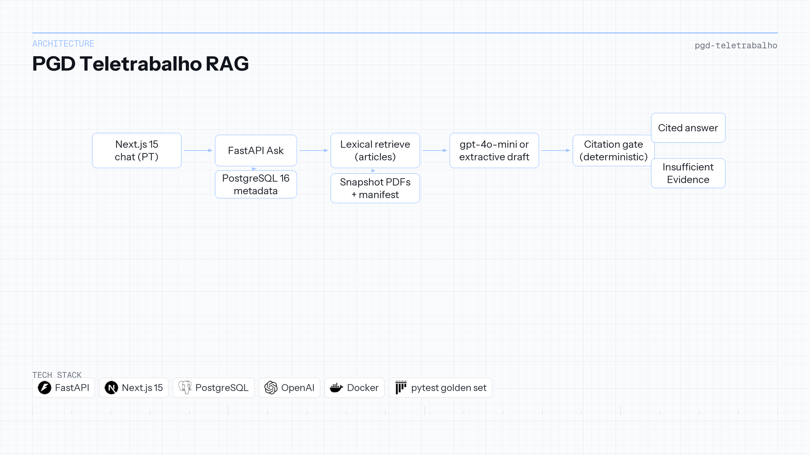

# PGD Telework Assistant (Unifesp)

| | |
|---|---|
| **Context** | Independent portfolio |
| **Timeline** | 2025 — 2026 |
| **Focus area** | Citation gate & normative RAG |

Python · FastAPI · Next.js · PostgreSQL · Docker · pytest

## Overview

A technical-administrative servidor at Unifesp asking about telework cannot trust an unconstrained answer. The reply must cite the normative act in force, point to an article on the PDF page, and refuse when the corpus does not support the claim. A superseded resolution must not be treated as current, and an amendment must not be silently merged into the act it changes.

One product seam, **Ask**: lexical retrieval over a dated snapshot of five numbered acts, a Portuguese draft, then a **deterministic citation gate**. Default retrieval uses Current acts; Resolução CONSU 213/2021 enters only for historical questions. FastAPI owns Ask, Next.js is a single chat shell, PostgreSQL holds act and article metadata. The same Compose file runs locally and on a DigitalOcean droplet.

Every surviving claim cites a retrieved article, or the response is **Insufficient Evidence**. Corpus cutoff: **18 September 2026**. **89** pytest tests pass with extractive draft and empty `OPENAI_API_KEY`, including a **43**-item golden set scored through Ask.

**Repository:** [Enterprise-Knowledge---RAG-Platform](https://github.com/OtnielGomes/Enterprise-Knowledge---RAG-Platform)

## Architecture

Snapshot PDFs, lexical retrieve, draft, citation gate—no LLM judge on the request path.

## Implementation walkthrough

### PHASE 01 — Snapshot ingest and metadata

Five public PDFs (CONSU 262/2025, federal decrees and instructions, superseded 213/2021) are copied into the API image with a manifest. PostgreSQL stores act status (Current vs Superseded) and article text for retrieval and gate checks.

### PHASE 02 — Lexical retrieval

Default candidate set is Current acts only. Historical markers widen the set to include 213/2021. v1 uses lexical overlap on articles—not vector search on the hot path.

### PHASE 03 — Draft generation

`gpt-4o-mini` produces a Portuguese JSON draft when a key is present. Empty key or API failure falls back to an extractive draft. Retrieval and gate do not depend on the chat model.

### PHASE 04 — Deterministic citation gate

A citation survives only if its `article_id` was retrieved or its quote appears in article text. Fabricated citations drop. If none remain, the API returns Insufficient Evidence—no LLM-as-judge.

### PHASE 05 — Tests, CI, and deploy

Golden-set categories (temporal, historical, unanswerable, amendment conflict) run through Ask. CI executes the same **89** tests without OpenAI secrets. Production uses the same `compose.yaml` as local dev.

## Tech stack deep-dive

### FastAPI (`Ask` API)

Single seam for retrieve → draft → gate keeps the contract testable end-to-end.

### Lexical retrieval

Predictable behavior for a small, versioned legal slice beats embedding search before you have eval coverage.

### Citation gate (Python)

Trust is enforced in code; the model only proposes text and citations to be verified.

### Next.js chat shell

Portuguese UI proxies Ask and serves PDFs at cited pages.

### PostgreSQL + pgvector (runtime slice)

Metadata store today; pgvector is in the stack but not on the v1 request path.

### Docker Compose

Local and droplet parity—one file, health checks, snapshot cutoff visible in ops.
