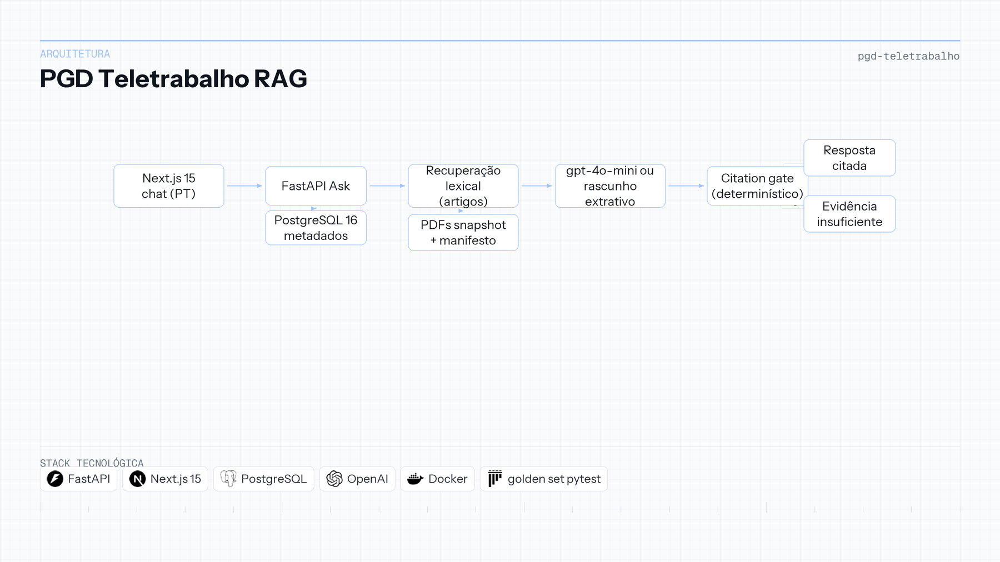

# Assistente PGD Teletrabalho (Unifesp)

| | |
|---|---|
| **Contexto** | Projeto de portfólio |
| **Linha do tempo** | 2025 — 2026 |
| **Foco** | Citation gate e RAG normativo |

Python · FastAPI · Next.js · PostgreSQL · Docker · pytest

## Visão geral

Servidor técnico-administrativo da Unifesp que pergunta sobre teletrabalho não pode confiar em resposta solta. A resposta precisa citar o ato normativo vigente, apontar artigo abrível no PDF e recusar quando o corpus não sustenta a afirmação. Ato revogado não pode parecer vigente; alteração não pode ser fundida em silêncio no ato que modifica.

Um único fluxo de produto, **Ask**: recuperação lexical sobre snapshot datado de cinco atos numerados, rascunho em português e **citation gate determinístico**. Por padrão só entram atos **Vigentes**; Resolução CONSU 213/2021 só em perguntas históricas. FastAPI concentra o Ask, Next.js é um chat único, PostgreSQL guarda metadados de atos e artigos. O mesmo `compose.yaml` roda local e em droplet na DigitalOcean.

Cada afirmação que sobrevive cita artigo recuperado, ou a resposta é **Evidência Insuficiente**. Corte do corpus: **18 de setembro de 2026**. **89** testes pytest passam com rascunho extrativo e `OPENAI_API_KEY` vazia, incluindo golden set de **43** itens avaliados pelo Ask.

**Repositório:** [Enterprise-Knowledge---RAG-Platform](https://github.com/OtnielGomes/Enterprise-Knowledge---RAG-Platform)

## Arquitetura

PDFs do snapshot, recuperação lexical, rascunho e gate de citação—sem juiz LLM no caminho da requisição.

## Passo a passo da implementação

### FASE 01 — Ingestão do snapshot e metadados

Cinco PDFs públicos (CONSU 262/2025, normas federais, 213/2021 revogada) entram na imagem da API com manifesto. O PostgreSQL registra status (Vigente vs Revogado) e texto dos artigos para busca e validação.

### FASE 02 — Recuperação lexical

O conjunto padrão são só atos vigentes. Marcadores históricos incluem 213/2021. A v1 usa sobreposição lexical em artigos—busca vetorial não está no caminho quente.

### FASE 03 — Geração do rascunho

`gpt-4o-mini` produz rascunho JSON em português quando há chave. Chave vazia ou falha de API cai no rascunho extrativo. Recuperação e gate não dependem do modelo de chat.

### FASE 04 — Citation gate determinístico

A citação só permanece se o `article_id` foi recuperado ou a citação literal está no texto do artigo. Citações fabricadas caem. Sem citações válidas, a API devolve Evidência Insuficiente—sem LLM-as-judge.

### FASE 05 — Testes, CI e deploy

Categorias do golden set (temporal, histórico, sem resposta, conflito de alteração) passam pelo Ask. A CI roda os mesmos **89** testes sem segredo OpenAI. Produção usa o mesmo `compose.yaml` do ambiente local.

## Stack em detalhe

### FastAPI (API Ask)

Um único seam retrieve → rascunho → gate torna o contrato testável de ponta a ponta.

### Recuperação lexical

Comportamento previsível em fatia jurídica pequena e versionada antes de apostar em embeddings sem eval.

### Citation gate (Python)

Confiança é código; o modelo só propõe texto e citações a verificar.

### Shell Next.js

Chat em português faz proxy do Ask e abre PDF na página citada.

### PostgreSQL + pgvector (fatia de runtime)

Metadados hoje; pgvector está no stack mas fora do caminho da v1.

### Docker Compose

Paridade local e droplet—um arquivo, health checks, data de corte visível em operação.
